# Der ganze Weg, Schritt für Schritt

*Vom Rohdatensatz zur Antwort: NLR, hs-CRP und Herzkrankheit in NHANES 2021–2023. Diese Anleitung erklärt jede Entscheidung so, dass du sie verstehst, verteidigen kannst und selbst nachbauen kannst. Sie benutzt fast nur Methoden aus den Vorlesungen W1–W9 und den Tutorials.*

---

## So ist jeder Schritt aufgebaut

| Baustein | Was er dir sagt |
|---|---|
| **Ziel** | Welche Frage dieser Schritt beantwortet |
| **Kurs** | In welcher Vorlesung oder welchem Tutorial die Methode vorkommt |
| **Drei Optionen** | Sinnvolle Alternativen, die man wählen könnte |
| **Wie wir entschieden haben** | Kriterium und Test (Literatur oder kleines Experiment) |
| **Ergebnis und Entscheidung** | Was herauskam und was wir gewählt haben |
| **So machst du es selbst** | Die Bausteine (Python-Funktionen), die du brauchst |
| **Prüffragen** | Fragen, die du danach beantworten können solltest |

**Grundprinzip:** Vor jedem Experiment wird die Entscheidungsregel aufgeschrieben (in `config.py`). Wer erst die Ergebnisse anschaut und dann die Regel wählt, findet fast immer eine Regel, die das gewünschte Ergebnis liefert.

**Die Skripte:** `01_prepare_data.py` → `02_descriptives.py` → `03_design_experiments.py` → `04_nested_cv.py` → `05_evaluate_models.py` → `06_association.py` → `07_interpretation.py`. Alle Ergebnisse landen in `results/`.

---

## Inhalt

1. [Die Forschungsfrage](#schritt-1--die-forschungsfrage)
2. [Die Daten und die Stichprobe](#schritt-2--die-daten-und-die-stichprobe)
3. [Variablen bauen und die Form der Marker](#schritt-3--variablen-bauen-und-die-form-der-marker)
4. [Beschreiben und testen (Table 1)](#schritt-4--beschreiben-und-testen-table-1)
5. [Fehlende Werte](#schritt-5--fehlende-werte)
6. [Welche Variablen kommen ins Modell?](#schritt-6--welche-variablen-kommen-ins-modell)
7. [Reicht die Stichprobe?](#schritt-7--reicht-die-stichprobe)
8. [Die seltene Krankheit](#schritt-8--die-seltene-krankheit-klassen-ungleichgewicht)
9. [Fair testen: Kreuzvalidierung](#schritt-9--fair-testen-kreuzvalidierung)
10. [Sechs Lernverfahren](#schritt-10--sechs-lernverfahren)
11. [Wie misst man «gut»?](#schritt-11--wie-misst-man-gut)
12. [Modelle statistisch vergleichen](#schritt-12--modelle-statistisch-vergleichen)
13. [Ergebnis Hauptfrage: der Zusammenhang (H1a, H1b)](#schritt-13--ergebnis-der-hauptfrage-h1a-h1b)
14. [Ergebnis Zusatzfrage: das Erkennen (H1c)](#schritt-14--ergebnis-der-zusatzfrage-h1c)
15. [Hängt das Ergebnis von unseren Entscheidungen ab?](#schritt-15--sensitivitätsanalysen)
16. [Was bedeutet das, und wo sind die Grenzen?](#schritt-16--interpretation-und-grenzen)
17. [Checkliste zum Nachbauen](#schritt-17--checkliste-zum-nachbauen)

---

## Schritt 1 – Die Forschungsfrage

**Ziel:** Eine Frage formulieren, die man mit diesen Daten wirklich beantworten kann.

**Kurs:** W1 (Research questions): Eine gute Frage ist *focused* (eng genug), *empirically testable* (mit Daten prüfbar), *feasible* (machbar) und *meaningful* (bringt etwas). Die W4-Checkliste fragt zusätzlich: *Does the ML approach make sense for the scientific or clinical question?*

**Unsere Frage (wie im Gruppen-README):**

> **Hauptfrage.** Sind ein höheres NLR und ein höheres hs-CRP bei US-Erwachsenen mit einer selbstberichteten koronaren Herzkrankheit oder einem Herzinfarkt (CHD/MI) verbunden, *unabhängig* von den etablierten Risikofaktoren?
> - **H1a:** NLR ist nach Adjustierung mit CHD/MI assoziiert.
> - **H1b:** hs-CRP ist nach Adjustierung mit CHD/MI assoziiert.
>
> **Zusatzfrage H1c.** Verbessern NLR und hs-CRP die *Erkennung* von CHD/MI über die etablierten Risikofaktoren hinaus, und hängt die Antwort vom Lernverfahren ab?

**Warum diese Reihenfolge?**

| Option | Problem / Stärke |
|---|---|
| A: «Sagen die Marker künftige Herzinfarkte voraus?» | Nicht machbar: NHANES 2021–2023 ist eine Momentaufnahme ohne Nachbeobachtung (nicht *feasible*). |
| B: «Erkennen die Marker Menschen mit Herzkrankheit?» als Hauptfrage | Wenig sinnvoll: Die Menschen wissen von ihrer Diagnose; ein Modell, das sie «erkennt», hat keinen praktischen Nutzen (nicht *meaningful*). |
| **C: Zusammenhang als Hauptfrage, Erkennen als Zusatzfrage** | **Sinnvoll und machbar.** Ein Zusammenhang mit bestehender Krankheit ist eine klassische Querschnittsfrage. Die Zusatzfrage ist eine Vorprüfung: Wenn die Marker *nicht einmal* bestehende Krankheit besser erkennen lassen, lohnt sich ein teurer Einsatz in der Vorsorge kaum. Sie erlaubt ausserdem den vom Kurs verlangten Vergleich mehrerer ML-Modelle. |

**Entscheidung:** C. Damit gibt es zwei *co-primäre* Hypothesen (H1a, H1b). Testet man zwei Hypothesen, steigt die Chance auf einen Zufallstreffer; deshalb wird jede mit α = 0.05 / 2 = 0.025 geprüft (Bonferroni, Tutorial 4).

**Was diese Studie nicht kann:** Ursache und Wirkung trennen. Ein Herzinfarkt kann die Entzündungswerte *erhöhen*; Medikamente nach der Diagnose können sie *senken*. Wir messen also «gemeinsames Auftreten», keine Ursache.

**So machst du es selbst:** Schreib die Frage als Satz mit Population (US-Erwachsene), Exposition (NLR, hs-CRP), Outcome (CHD/MI) und Vergleich (adjustiert für Risikofaktoren). Leite daraus H0 und H1 ab, bevor du Daten anschaust.

**Prüffragen:**
- Warum ist «Vorhersage künftiger Herzinfarkte» mit diesen Daten nicht möglich?
- Was ist der Unterschied zwischen «assoziiert» und «verursacht»?
- Warum testen wir jeden Marker bei 0.025 und nicht bei 0.05?

---

## Schritt 2 – Die Daten und die Stichprobe

**Ziel:** Wissen, wer in der Analyse ist und wer warum fehlt.

**Kurs:** W3 (Population, sample, sampling, representativeness); W2-Checkliste (*What is missing? Where? Why?*).

**NHANES** ist eine US-Gesundheitsstudie mit Interview, Untersuchung im mobilen Untersuchungszentrum (MEC) und Blutprobe. Die Teilnehmenden werden so ausgewählt, dass sie zusammen die US-Bevölkerung abbilden. Manche Gruppen (z. B. ältere Menschen, Minderheiten) werden absichtlich *überproportional* befragt; Gewichte gleichen das für Bevölkerungsaussagen wieder aus.

**Der Weg zur Stichprobe** (`results/tables/flowchart.csv`, Abbildung `fig01`):

| Schritt | Personen | Fälle |
|---|---:|---:|
| Alle Teilnehmenden | 11'933 | 559 |
| Erwachsene (≥ 20 Jahre) | 7'809 | 559 |
| CHD/MI-Frage beantwortet | 7'773 | 559 |
| Im Untersuchungszentrum | 6'037 | 451 |
| **NLR und hs-CRP gemessen** | **5'538** | **412 (7.4 %)** |

**Outcome:** «Hat Ihnen je eine Ärztin gesagt, Sie hätten eine koronare Herzkrankheit / einen Herzinfarkt gehabt?» (MCQ160C oder MCQ160E). Varianten für die Sensitivitätsanalysen: nur Herzinfarkt, nur KHK, mit Angina pectoris.

**Wer fehlt, und ist das schlimm?** Wir vergleichen die Ausgeschlossenen mit der Stichprobe über die *standardisierte Mittelwertdifferenz* (SMD = Unterschied der Mittelwerte geteilt durch die Standardabweichung; |SMD| < 0.1 gilt als klein). Menschen ohne Blutprobe sind ärmer (SMD −0.36) und häufiger nicht-hispanisch schwarz (Abbildung `fig06`). Das schränkt die Übertragbarkeit ein und kommt in die Limitationen.

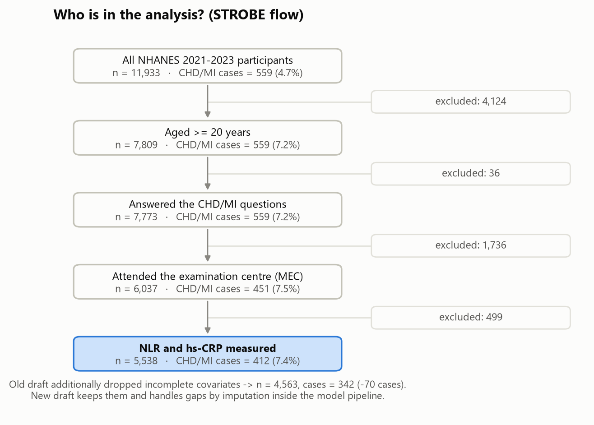

**So machst du es selbst:** Filter Schritt für Schritt (`df[df.age >= 20]` …) und notiere nach jedem Schritt die Anzahl Personen und Fälle. Das ergibt das Flussdiagramm.

**Prüffragen:**
- Warum ist «7.4 % Prävalenz» keine Schätzung für die ganze US-Bevölkerung? (Hinweis: Gewichte.)
- Warum vergleichen wir die Ausgeschlossenen mit SMD und nicht mit p-Werten? (Hinweis: Bei Tausenden von Personen ist jeder kleine Unterschied «signifikant».)

---

## Schritt 3 – Variablen bauen und die Form der Marker

**Ziel:** Saubere Variablen und eine sinnvolle Skala für die Marker.

**Kurs:** W2 (Data wrangling, Ausreisser), W3 (Verteilungsform, Schiefe, Q-Q-Plot, Normalitätstests).

**Wichtige Variablen** (`01_prepare_data.py`):
- **NLR** = Neutrophile / Lymphozyten (aus dem Blutbild).
- **hs-CRP** in mg/L.
- **Bluthochdruck** = vom Arzt diagnostiziert *oder* gemessen ≥ 140/90 mmHg.
- **eGFR** (Nierenfunktion) nach der CKD-EPI-2021-Formel ohne Ethnie.
- **Rauchen** (nie / früher / aktuell), Diabetes, Cholesterin, HDL, BMI, Einkommen (Einkommen-Armuts-Verhältnis), Ethnie, Alter, Geschlecht.

**Die Form der Marker: drei Optionen**

| Option | Schiefe NLR / CRP | Beurteilung |
|---|---|---|
| A: Rohwerte | 4.66 / 7.78 | Stark rechtsschief: Wenige Extremwerte dominieren. Die IQR-Regel markiert 232 bzw. 469 Werte als «Ausreisser». |
| **B: Logarithmus** | **0.15 / 0.23** | **Fast symmetrisch (Q-Q-Plot, `fig07`).** |
| C: Kategorien (CRP < 1 / 1–3 / > 3 mg/L; NLR-Quartile) | – | Klinisch anschaulich, verschenkt aber Information |

**Entscheidung:** B für alle Modelle, C zusätzlich zur Veranschaulichung (Schritt 13). Effekte werden «pro Standardabweichung des log-Markers» angegeben. Eine SD des log-NLR entspricht einem Faktor 1.58 auf der Originalskala (z. B. NLR 2.0 → 3.2), eine SD des log-CRP einem Faktor 3.15 (z. B. 1.8 → 5.7 mg/L).

**Warum kein Normalitätstest als Kriterium?** Bei n = 5'538 lehnt der Shapiro-Wilk-Test selbst kleinste Abweichungen ab (p < 0.001 auf beiden Skalen). Der Kurs (W3) zeigt genau das: Bei grossen Stichproben sagen Q-Q-Plot und Schiefe mehr als der p-Wert.

**Ausreisser:** Extreme Entzündungswerte sind biologisch möglich (z. B. Infekt) und keine Messfehler. Wir behalten sie und prüfen in Schritt 15, ob das Ergebnis ohne sie anders wäre (IQR-Regel aus W2; hs-CRP > 10 mg/L als Hinweis auf akuten Infekt).

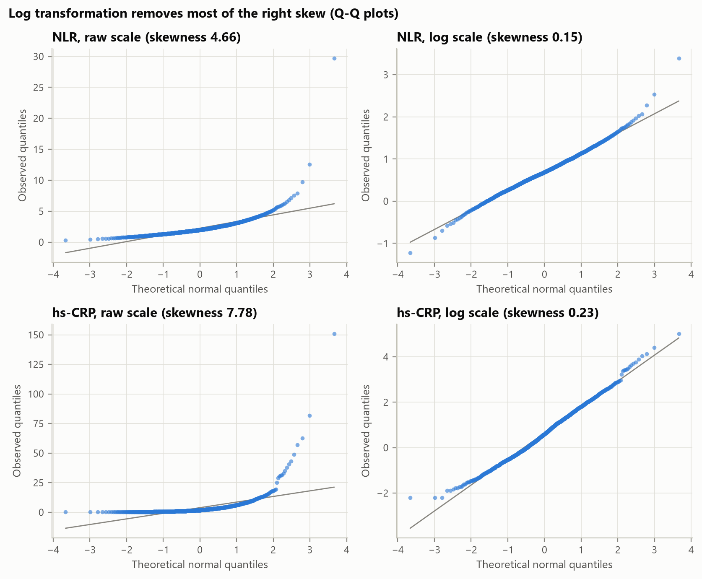

**So machst du es selbst:** `np.log(df.nlr)`, `scipy.stats.skew`, `scipy.stats.probplot` (Q-Q-Plot), IQR mit `np.quantile(v, [0.25, 0.75])`.

**Prüffragen:**
- Warum hilft der Logarithmus bei rechtsschiefen Daten?
- Warum entfernen wir die Ausreisser nicht einfach?
- Was bedeutet «OR pro SD des log-NLR» in Worten?

---

## Schritt 4 – Beschreiben und testen (Table 1)

**Ziel:** Wie unterscheiden sich Kranke und Gesunde, bevor man irgendetwas modelliert?

**Kurs:** W3 (Kennzahlen, nicht-parametrische Tests), Tutorial 4 (Tests, Bonferroni).

**Drei Optionen für den Gruppenvergleich**

| Option | Wann geeignet |
|---|---|
| t-Test / ANOVA | Wenn die Daten ungefähr normalverteilt sind |
| **Mann-Whitney-U (stetig) und Chi-Quadrat (kategorial)** | **Robust bei schiefen Daten. Unsere Marker sind schief → diese Wahl** |
| Nur Effektgrösse (SMD) ohne Test | Bei sehr grossem n oft aussagekräftiger |

**Entscheidung:** Wir zeigen beides, Tests mit Bonferroni-Korrektur (viele Variablen = viele Tests) *und* SMD. Medianwerte mit Interquartilsabstand, weil die Daten schief sind.

**Die wichtigsten Befunde** (`results/tables/table1.csv`):
- Fälle sind älter (Median 70 vs. 55 Jahre), häufiger männlich (65 % vs. 44 %), häufiger zuckerkrank (37 % vs. 12 %) und haben häufiger Bluthochdruck (78 % vs. 42 %).
- **NLR ist bei Fällen höher** (Median 2.39 vs. 1.96; SMD 0.42).
- **hs-CRP unterscheidet sich schon ohne jede Adjustierung kaum** (1.97 vs. 1.81 mg/L; SMD 0.02; Mann-Whitney p = 0.256, nach Bonferroni p = 1.000).
- **Das Statin-Paradox:** Fälle haben *tieferes* Cholesterin (152 vs. 187 mg/dL), weil 78 % von ihnen Cholesterinsenker nehmen (25 % der Gesunden). Die Diagnose führt zur Behandlung, die Behandlung senkt den Wert (`fig03`).

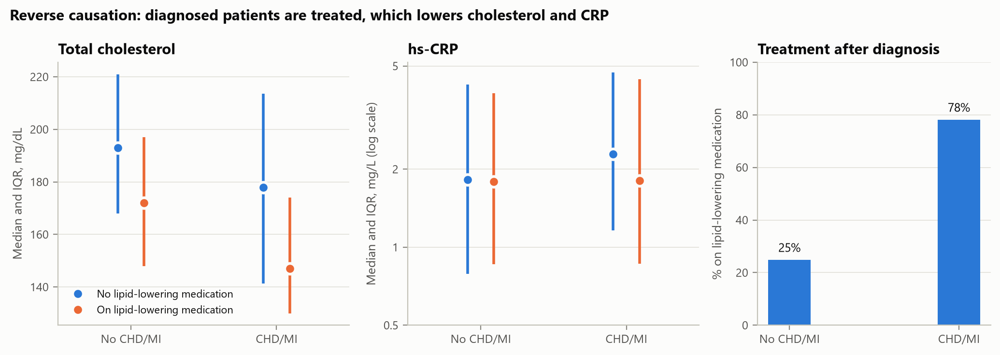

**So machst du es selbst:** `scipy.stats.mannwhitneyu`, `scipy.stats.chi2_contingency`, Bonferroni: jeden p-Wert mal Anzahl Tests (maximal 1).

**Prüffragen:**
- Warum Mann-Whitney statt t-Test?
- Was macht die Bonferroni-Korrektur, und warum braucht man sie?
- Warum ist das tiefere Cholesterin der Kranken kein Hinweis darauf, dass Cholesterin schützt?

---

## Schritt 5 – Fehlende Werte

**Ziel:** Möglichst niemanden unnötig verlieren, ohne die Ergebnisse zu verzerren.

**Kurs:** W2 (MCAR / MAR / MNAR; listwise deletion, Spalte löschen, Median-Imputation; «missing data can hold information»).

**Wo fehlt etwas?** Am meisten beim Einkommen (12.7 %), sonst wenig (BMI 1.3 %, Blutdruck 3 %, Cholesterin 1.7 %, eGFR 2.7 %; `missingness.csv`, `fig05`).

**Warum fehlt es?** Ein kleines Modell für «Einkommen fehlt» zeigt: Das Fehlen hängt von Ethnie, Bildung und Rauchen ab (also nicht rein zufällig, kein MCAR), aber **nicht von der Herzkrankheit** (OR 1.03, 95 %-KI 0.75–1.42) und nicht von den Markern. Das passt zu MAR: Das Fehlen hängt von beobachteten Dingen ab.

**Drei Optionen (genau die aus W2)**

| Option | Vorteil | Nachteil (laut W2) |
|---|---|---|
| A: Listwise deletion (nur Vollständige) | Einfach, keine erfundenen Werte | Verliert 975 Personen (70 Fälle); verzerrt, wenn nicht MCAR |
| B: Spalte «Einkommen» löschen | Alle Personen bleiben | Einkommen ist ein Risikofaktor → mögliche Verzerrung durch die fehlende Variable |
| **C: Median einsetzen + Indikator «Einkommen fehlte»** | **Alle Personen und Variablen bleiben; der Indikator nutzt, dass «fehlend» selbst Information sein kann** | Median-Imputation unterschätzt die Streuung |

**Regel (vorher festgelegt):** C, ausser A oder B ist auf denselben Testpersonen um mehr als 0.005 AUC besser.

**Experiment E1:** Alle drei Optionen werden mit logistischer Regression und Random Forest in derselben Kreuzvalidierung trainiert. Verglichen wird auf denselben Personen, nämlich den Vollständigen, denn nur sie kann Option A überhaupt bewerten.

| Option | Trainingspersonen (Mittel) | AUC auf denselben Testpersonen: logistische Regression | … Random Forest | AUC bei Personen mit Lücken (log. Regression) |
|---|---:|---|---|---|
| A: Listwise deletion | 3'650 | 0.867 (0.849–0.884) | 0.865 (0.844–0.886) | nicht möglich |
| B: Einkommen gelöscht | 4'430 | 0.867 (0.847–0.887) | 0.866 (0.847–0.886) | 0.848 |
| C: Median + Indikator | 4'430 | 0.867 (0.848–0.886) | 0.868 (0.846–0.889) | 0.849 |

**Entscheidung:** C (Median + Indikator). Keine andere Option ist um mehr als 0.005 besser (mittlere AUC beider Verfahren auf denselben Testpersonen: A 0.866, B 0.867, C 0.867). Dafür bleiben alle 5'538 Personen in der Analyse, und auch Menschen mit Lücken bekommen eine Vorhersage. Die Imputation wird *innerhalb* jedes Trainingsteils berechnet (der Median kommt nur aus den Trainingsdaten), sonst würden Informationen aus den Testdaten durchsickern.

**Für die Assoziationsanalyse** (Schritt 13) rechnen wir alle drei Optionen durch und zeigen, dass das Ergebnis nicht von der Wahl abhängt.

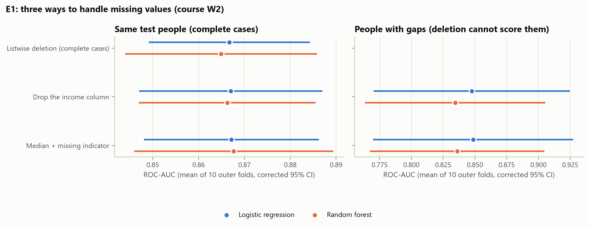

**So machst du es selbst:** `SimpleImputer(strategy="median")`, einen eigenen Indikator `df["income_missing"] = df.income_pir.isna()`, alles in einer `Pipeline`, damit es pro Trainingsfold neu gelernt wird.

**Prüffragen:**
- Was ist der Unterschied zwischen MCAR, MAR und MNAR? Welcher Fall liegt beim Einkommen vor?
- Warum muss die Imputation innerhalb der Kreuzvalidierung passieren?
- Warum vergleichen wir die Optionen auf denselben Testpersonen?

---

## Schritt 6 – Welche Variablen kommen ins Modell?

**Ziel:** Ein Referenzmodell mit den etablierten Risikofaktoren, zu dem wir die Marker hinzufügen.

**Kurs:** W4/W6 (Feature selection: filter, wrapper, embedded), W5 (Lasso).

**Die Feature-Sets:**
- **M0:** Alter, Geschlecht.
- **M1:** + Ethnie, Einkommen, BMI.
- **M2:** + Rauchen, Diabetes, Bluthochdruck, Gesamt- und HDL-Cholesterin, eGFR. Das sind die etablierten Risikofaktoren aus den grossen Risikorechnern (Pooled Cohort Equations, SCORE2, QRISK3, PREVENT, INTERHEART).
- **M3:** M2 + NLR + hs-CRP.
- Zusätzlich: M2 + nur NLR, M2 + nur hs-CRP.
- **Referenz (Vorschlag des TA): die Marker allein.** M4 = NLR + hs-CRP, dazu NLR allein und hs-CRP allein, ohne jeden Risikofaktor. M4 beantwortet nicht die Forschungsfrage («über die Risikofaktoren hinaus»), zeigt aber, wie viel die Blutwerte *für sich* trennen können. Es ist für die Erkennung das, was das unadjustierte Odds Ratio für den Zusammenhang ist. Gerechnet wird nur mit logistischer Regression: Bei 1–2 Variablen kann ein flexibles Verfahren kaum mehr finden.

**Der entscheidende Gedanke:** Die Frage lautet «über die *etablierten* Risikofaktoren hinaus». Das Referenzmodell ist also durch die Frage *definiert*: Es sind die Faktoren, die in der Praxis verwendet werden. Ein Computer-optimiertes Set würde die Frage verändern. Das Experiment E2 dient deshalb nicht der Wahl von M2, sondern prüft zwei Dinge: (1) Was passiert, wenn man den Computer frei wählen lässt? (2) Wählen datengetriebene Methoden die Marker selbst aus?

**Drei Strategien**

| Strategie | Idee |
|---|---|
| **S1 Literatur (M3)** | Die etablierten Faktoren plus Marker |
| S2 Alles + Lasso | Lasso wählt frei aus 342 Rohvariablen (≤ 40 % fehlend) |
| S3 Vorauswahl + Methode | Fachliche Vorauswahl von 39 Variablen, dann filter (F-Test, `SelectKBest`), wrapper (`RFECV`) oder embedded (Lasso) |

**Ergebnis E2** (`e2_feature_selection_summary.csv`, `fig09`):
- **S2 wird scheinbar viel besser (AUC 0.923 statt 0.862), aber durch Datenleck.** Der Lasso wählt «Metallteile im Körper?» (Stents), «Arzt riet zu Aspirin», «Herzinsuffizienz», «Anzahl Medikamente», «nimmt Cholesterinsenker». Das sind *Folgen* der Diagnose, keine Risikofaktoren. 35 % der 20 meistgewählten Variablen sind solche Lecks.
- **S3 ist nur minimal besser (0.869–0.870, +0.008)** und weniger stabil: Je nach Fold werden andere Variablen gewählt (Stabilität 0.69–0.86 statt 1.00).
- **NLR wird von allen drei S3-Methoden in jedem Fold gewählt; hs-CRP vom Filter nie, von RFECV in 90 %, vom Lasso immer.**

**Entscheidung:** S1 (M2 + Marker). Es ist durch die Frage vorgegeben, stabil, frei von Lecks und praktisch genauso gut.

**Selbstkritik (wichtig!):** Mit derselben Leck-Logik müsste man auch das *Cholesterin* kritisch sehen. Wir haben «nimmt Cholesterinsenker» als Leck erkannt, aber das Cholesterin selbst ist durch die Statine verändert und wird zum zweitwichtigsten Prädiktor, und zwar *invers*. Der Marker-Vergleich bleibt fair, weil M2 und M3 dasselbe Cholesterin enthalten. Schritt 15 zeigt, wie gut M2 *ohne* Cholesterin ist und dass sich am Marker-Gewinn nichts ändert.

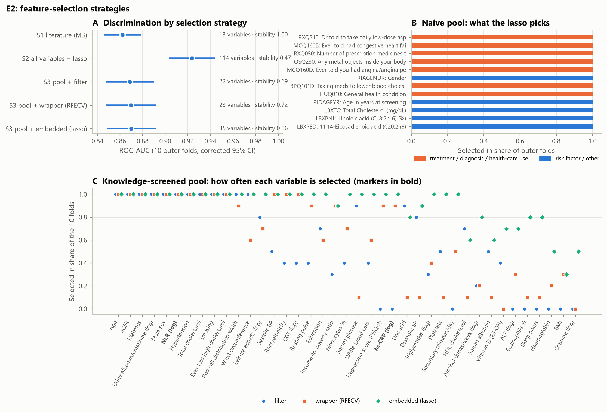

**So machst du es selbst:** `SelectKBest(f_classif)`, `RFECV`, `LogisticRegression(l1_ratio=1, solver="liblinear")` (Lasso), jeweils *in* der Pipeline und mit `GridSearchCV` für die Stärke.

**Prüffragen:**
- Was ist ein Datenleck (label leakage)? Nenne ein Beispiel aus E2.
- Warum ist das Referenzmodell durch die Forschungsfrage vorgegeben?
- Was unterscheidet filter-, wrapper- und embedded-Methoden?

---

## Schritt 7 – Reicht die Stichprobe?

**Ziel:** Begründen, dass das Modell nicht zu viele Parameter für die Anzahl Fälle hat.

**Kurs:** W3-Checkliste: *Was the sample size justified (e.g. through a statistical calculation)?*

**Faustregel:** Mindestens **10 Fälle pro geschätztem Koeffizienten** (events per parameter, EPV). M3 hat 19 Koeffizienten (Ethnie zählt 5-fach, Rauchen 2-fach, dazu der Einkommens-Indikator).

| Situation | Fälle | Koeffizienten | Fälle pro Koeffizient |
|---|---:|---:|---:|
| Ganze Stichprobe | 412 | 19 | 21.7 |
| Äusserer Trainingsteil (4/5) | 329 | 19 | 17.3 |
| Innerer Trainingsteil (4/5 von 4/5) | 263 | 19 | 13.8 |
| Erster Entwurf: 80 % der Vollständigen | 273 | 19 | 14.4 |

**Entscheidung:** Die unpenalisierte logistische Regression ist vertretbar. Für grössere Variablensets (wie den S3-Pool mit 39 Variablen) braucht es Regularisierung (Lasso/Ridge, W5).

**Prüffragen:** Warum zählt bei einer seltenen Krankheit die Zahl der *Fälle* und nicht die Zahl der Personen?

---

## Schritt 8 – Die seltene Krankheit (Klassen-Ungleichgewicht)

**Ziel:** Mit 7.4 % Fällen umgehen, ohne die Modelle zu verschlechtern.

**Kurs:** W9 (accuracy paradox, oversampling, undersampling, SMOTE), Tutorial 8 (`class_weight`).

**Das Genauigkeits-Paradox:** «Alle sind gesund» liegt in 92.6 % der Fälle richtig und findet keinen einzigen Kranken. Genauigkeit (accuracy) ist bei seltenen Krankheiten deshalb kein gutes Mass.

**Fünf Optionen** (hier mehr als drei, weil der Kurs alle behandelt):

| Option | Idee |
|---|---|
| **Keine Korrektur** | **Natürliche Häufigkeit behalten, die Entscheidungsschwelle bewusst wählen** |
| Klassengewichte | Jeder Fall zählt im Training ~12-mal |
| Oversampling | Fälle im Training kopieren |
| Undersampling | Gesunde im Training weglassen |
| SMOTE | Neue, künstliche Fälle zwischen echten Fällen und ihren Nachbarn erzeugen |

**Regel (vorher festgelegt):** Eine Korrektur nur, wenn sie die AUC um mehr als 0.005 erhöht *und* den Brier-Score nicht verschlechtert. Der Brier-Score ist der mittlere quadratische Fehler der Wahrscheinlichkeiten (wie der MSE aus W5, nur für Wahrscheinlichkeiten).

**Experiment E3** (logistische Regression und Random Forest, `e3_imbalance_summary.csv`, `fig10`):

| Option | AUC LR | AUC RF | Brier LR | Brier RF | Mittleres Risiko LR | Mittleres Risiko RF |
|---|---|---|---|---|---|---|
| Keine Korrektur | 0.862 | 0.861 | 0.058 | 0.058 | 7.4 % | 7.4 % |
| Klassengewichte | 0.862 | 0.863 | 0.156 | 0.111 | 31.9 % | 26.4 % |
| Oversampling | 0.861 | 0.860 | 0.156 | 0.108 | 31.9 % | 25.5 % |
| Undersampling | 0.856 | 0.858 | 0.164 | 0.167 | 32.6 % | 38.0 % |
| SMOTE | 0.860 | 0.857 | 0.151 | 0.094 | 30.0 % | 22.1 % |
| *(wahre Häufigkeit)* | | | | | *7.4 %* | *7.4 %* |

**Was man daraus lernt:** Alle Korrekturen ändern die *Rangfolge* (AUC) kaum, verderben aber die *Wahrscheinlichkeiten*. Das Modell behauptet dann im Schnitt ein Risiko von 22–38 % statt 7.4 %. Senkt man stattdessen einfach die Schwelle, erreicht man dieselbe Trefferquote bei Kranken: Bei logistischer Regression ohne Korrektur werden bei Schwelle 0.5 nur 9 % der Kranken erkannt, bei einer Schwelle in Höhe der Prävalenz 82 %.

**Entscheidung:** Keine Korrektur. Keine der vier Korrekturen erhöht die AUC um mehr als 0.005, und alle verschlechtern den Brier-Score.

**Die eine Ausnahme: die SVM.** Ohne Gewichte bricht die SVM bei 7.4 % Fällen zusammen: Ihre bequemste Lösung ist «alle gesund», und die AUC lag im ersten Lauf bei nur 0.76. Bei der SVM schadet die Gewichtung den Wahrscheinlichkeiten nicht, weil diese ohnehin erst nachträglich aus den SVM-Werten berechnet werden (mit einer kleinen logistischen Regression, siehe Schritt 10). Deshalb bekommt nur die SVM Gewichte. Diese Korrektur wurde erst nach dem ersten Lauf gefunden. Das ist eine nachträgliche Änderung und wird so berichtet; beide Ergebnisse sind archiviert.

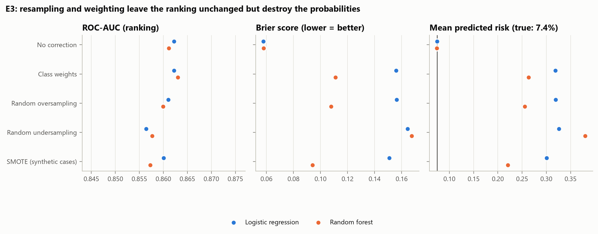

**So machst du es selbst:** `class_weight="balanced"`; Over- und Undersampling durch Ziehen von Zeilen *nur im Trainingsteil*; SMOTE: `smote()` in `common.py` (die Funktion ist kommentiert und zeigt jeden Schritt). SMOTE kommt *nach* der Imputation und Skalierung und *nie* auf die Testdaten.

**Prüffragen:**
- Erkläre das Genauigkeits-Paradox mit unseren Zahlen.
- Warum verändert Oversampling die vorhergesagten Wahrscheinlichkeiten?
- Warum darf SMOTE nie auf die Testdaten angewendet werden?

---

## Schritt 9 – Fair testen: Kreuzvalidierung

**Ziel:** Eine verlässliche Schätzung, wie gut ein Modell bei *neuen* Menschen ist.

**Kurs:** W4 (train/test split, cross-validation, overfitting), W5 und Tutorials 7/8 (`GridSearchCV`, nested CV).

**Drei Optionen**

| Option | Problem |
|---|---|
| A: Einmal 80/20 teilen (erster Entwurf) | Ergebnis hängt stark vom Zufall der Teilung ab |
| B: Kreuzvalidierung, Einstellungen auf denselben Folds wählen | Zu optimistisch: Die Einstellungen wurden auf den Testdaten «ausgesucht» |
| **C: Wiederholte verschachtelte Kreuzvalidierung** | **Ehrlich und stabil** |

**Experiment E4 (die «Lotterie»):** Dasselbe Modell auf 200 zufälligen 80/20-Teilungen ergibt AUC-Werte zwischen **0.80 und 0.92**. In **29.5 %** der Teilungen sieht es so aus, als würden die Marker *schaden*. Ein einzelner Split ist also Glückssache (`fig11`).

**So funktioniert C:**
1. **Äussere Schleife:** Die Daten werden in 5 Teile geteilt (stratifiziert: jeder Teil hat 7.4 % Fälle). Jeder Teil ist einmal Testteil. Das wird 3-mal mit anderen Zufallsteilungen wiederholt → **15 Testergebnisse**.
2. **Innere Schleife:** *Innerhalb* der 4 Trainingsteile sucht `GridSearchCV` mit einer zweiten 5-fachen CV die besten Einstellungen (Hyperparameter).
3. **Pipeline:** Imputation, Skalierung und One-Hot-Codierung werden in jedem Trainingsteil neu gelernt. Der Testteil wird erst ganz am Schluss berührt.

Alle Verfahren und Feature-Sets sehen **exakt dieselben Folds**. Das macht die Vergleiche *gepaart* (Schritt 12).

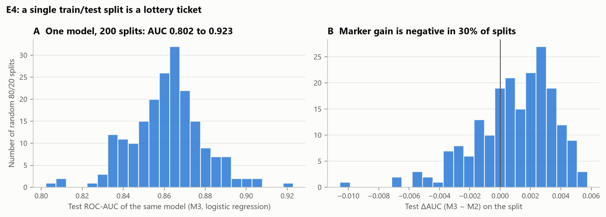

**So machst du es selbst:** `RepeatedStratifiedKFold(n_splits=5, n_repeats=3)` aussen, `GridSearchCV(..., cv=StratifiedKFold(5))` innen, alles in einer `Pipeline`.

**Prüffragen:**
- Warum ist ein einzelner 80/20-Split unzuverlässig?
- Was wäre falsch daran, die Hyperparameter auf denselben Folds zu wählen, auf denen man testet?
- Was bedeutet «stratifiziert»?

---

## Schritt 10 – Sechs Lernverfahren

**Ziel:** Prüfen, ob die Antwort vom Verfahren abhängt, und das einfachste gute wählen.

**Kurs:** W5–W9. Alle sechs Verfahren kommen im Kurs vor.

| Verfahren | Kurs | Idee in einem Satz | Eingestellte Hyperparameter (innere CV) |
|---|---|---|---|
| Logistische Regression | W6–W7 | Punktesystem → Wahrscheinlichkeit über die Sigmoid-Kurve | keine (klassische Form) |
| Ridge / Lasso / Elastic Net | W5–W6 | Logistische Regression mit Strafe für grosse Koeffizienten | Stärke C, Mischung L1/L2 |
| Entscheidungsbaum | W7 | Ja/Nein-Fragen hintereinander | Tiefe, Mindestgrösse der Blätter |
| k-nächste Nachbarn | W6/W8 | Anteil Kranker unter den k ähnlichsten Menschen | k, Gewichtung, Distanzmass |
| SVM (RBF-Kernel) | W9 | Gekrümmte Grenze mit möglichst breitem Abstand | C, γ |
| Random Forest | W8 | Viele Bäume auf Bootstrap-Stichproben stimmen ab | Anteil Variablen pro Split, Blattgrösse |

**Wichtige Details:**
- **Skalierung** (W4-Checkliste: *Are features properly scaled?*): kNN, SVM und penalisierte Regression brauchen skalierte Variablen (`StandardScaler`), sonst dominiert die Variable mit den grössten Zahlen. Bäume brauchen das nicht.
- **Optimierungsziel der Suche:** die *log-loss*, also die negative Log-Likelihood, mit der die logistische Regression geschätzt wird (W7). Sie belohnt gute Rangfolge *und* ehrliche Wahrscheinlichkeiten. Die AUC allein könnte ein Modell mit falschen Wahrscheinlichkeiten auswählen.
- **SVM-Wahrscheinlichkeiten:** Eine SVM liefert keine Wahrscheinlichkeiten (W9: *no direct probability outputs*), sondern einen Abstand zur Grenze. Diesen Abstand übersetzt eine kleine logistische Regression in eine Wahrscheinlichkeit (Platt-Skalierung).
- **Regel für das finale Modell** (W4-Checkliste: *Have simpler models been considered before complex ones?*): Logistische Regression, ausser ein anderes Verfahren ist *signifikant* besser.

**So machst du es selbst:** `LogisticRegression`, `DecisionTreeClassifier`, `KNeighborsClassifier`, `SVC` + `CalibratedClassifierCV`, `RandomForestClassifier`; Raster siehe `make_model()` in `common.py`.

**Prüffragen:**
- Warum braucht kNN skalierte Daten, ein Baum aber nicht?
- Warum wählen wir die Einstellungen über die log-loss und nicht über die Genauigkeit?
- Warum ist die einfache logistische Regression die Vorgabe?

---

## Schritt 11 – Wie misst man «gut»?

**Ziel:** Die richtigen Masse für eine seltene Krankheit.

**Kurs:** W9 (Konfusionsmatrix, Sensitivität, Spezifität, Schwelle, ROC/AUC, PR-Kurve), W5/W6/W9 (Kalibrierung).

| Mass | Bedeutung | Warum wir es brauchen |
|---|---|---|
| **ROC-AUC** (Hauptmass) | Wahrscheinlichkeit, dass ein zufälliger Kranker ein höheres Risiko bekommt als ein zufälliger Gesunder (0.5 = Zufall, 1 = perfekt) | Unabhängig von einer Schwelle (W9) |
| PR-AUC | Fläche unter der Precision-Recall-Kurve; die Zufallslinie liegt bei 0.074 | Zeigt die Schwierigkeit bei seltenen Fällen |
| Kalibrierung | Stimmen die Prozentzahlen? (10 % Risiko → 10 von 100 krank) | Ein Modell kann gut ordnen und trotzdem falsche Prozente nennen |
| Brier-Score | Mittlerer quadratischer Fehler der Wahrscheinlichkeiten | Fasst Rangfolge und Kalibrierung zusammen |
| Sensitivität, Spezifität, PPV, NPV, F1 | Aus der Konfusionsmatrix bei einer Schwelle | Was in der Praxis bei einer Entscheidung passiert |

**Die Schwelle:** Die Schwelle wird *im Trainingsteil* so gewählt, dass Sensitivität + Spezifität maximal werden (der Punkt der ROC-Kurve, der am weitesten von der Diagonalen entfernt ist; «Youden-Index»). Danach wird sie unverändert auf den Testteil angewendet.

**So machst du es selbst:** `roc_auc_score`, `average_precision_score`, `brier_score_loss`, `confusion_matrix`, `calibration_curve`, `roc_curve`.

**Prüffragen:**
- Warum ist die AUC bei 7.4 % Prävalenz besser als die Genauigkeit?
- Was bedeutet eine AUC von 0.86 in einem Satz?
- Warum wird die Schwelle im Trainingsteil gewählt und nicht im Testteil?

---

## Schritt 12 – Modelle statistisch vergleichen

**Ziel:** Entscheiden, ob ein Unterschied echt ist oder Zufall.

**Kurs:** W3 / Tutorial 4 (gepaarter t-Test, Bonferroni), W9 (Hypothesentest, α).

**Drei Optionen**

| Option | Problem / Stärke |
|---|---|
| A: Unterschied «nach Augenmass» | Kein Mass für Zufall |
| B: Normaler gepaarter t-Test über die 15 Folds | Zu optimistisch, weil sich die Trainingsdaten der Folds zu 75 % überschneiden. Die 15 Werte sind nicht unabhängig. |
| **C: Gepaarter t-Test mit Korrektur für die Überschneidung** | **Korrekte Unsicherheit** |

**Wie C funktioniert:** Für jeden der 15 Folds berechnen wir die Differenz (z. B. AUC M3 − AUC M2) auf *denselben* Testpersonen. Das ist der gepaarte t-Test aus Tutorial 4. Weil die Folds überlappen, wird die Varianz etwas vergrössert: Statt s²/15 nimmt man (1/15 + 1/4)·s². Das macht das Konfidenzintervall breiter und ehrlicher (Nadeau & Bengio 2003).

**Mehrfachtests:** Bei 6 Verfahren gibt es 6 Tests pro Frage → **Bonferroni** (p mal 6).

**Ein wichtiger Unterschied:** Ob ein Marker *überhaupt Information* enthält, prüft man am besten mit dem p-Wert seines Koeffizienten in der logistischen Regression (Wald-Test, W7) oder mit einem Likelihood-Ratio-Test (Schritt 13). Die AUC-Differenz misst etwas anderes, nämlich ob die *Erkennung* spürbar besser wird. Ein Marker kann Information enthalten und die AUC trotzdem kaum verändern.

**Prüffragen:**
- Warum ist der Vergleich «gepaart»?
- Warum braucht der t-Test über CV-Folds eine Korrektur?
- Was ist der Unterschied zwischen «Information hinzufügen» und «die Erkennung verbessern»?

---

## Schritt 13 – Ergebnis der Hauptfrage (H1a, H1b)

**Ziel:** Hängen NLR und hs-CRP nach Adjustierung mit CHD/MI zusammen?

**Kurs:** W7 (logistische Regression mit statsmodels: Odds Ratio, Wald-p, VIF, Interaktion), W2 (fehlende Werte), W3 (Repräsentativität).

**Drei verschachtelte Modelle**

| Modell | Enthält | Rolle |
|---|---|---|
| Modell 1 | Alter, Geschlecht | Grobe Sicht |
| **Modell 2** | **+ alle etablierten Risikofaktoren** | **Hauptmodell** |
| Modell 3 | + Cholesterinsenker | Nur Sensitivität |

**Warum Modell 2 als Hauptmodell?** Cholesterinsenker sind grösstenteils eine *Folge* der Diagnose (78 % der Fälle vs. 25 %). Für eine Folge des Outcomes zu adjustieren kann das Ergebnis verzerren. Statine senken aber auch hs-CRP; deshalb rechnen wir Modell 3 als Sensitivität mit.

**Ergebnis** (Odds Ratio pro SD des log-Markers, `assoc_odds_ratios.csv`, `fig18`):

| Modell | NLR: OR (95 %-KI) | p | hs-CRP: OR (95 %-KI) | p |
|---|---|---|---|---|
| Modell 1 | 1.30 (1.17–1.44) | < 0.001 | 1.11 (0.99–1.24) | 0.066 |
| **Modell 2** | **1.20 (1.07–1.34)** | 0.002 | **0.96 (0.84–1.08)** | 0.48 |
| Modell 3 | 1.21 (1.08–1.36) | 0.001 | 0.99 (0.87–1.13) | 0.92 |

*Modell 2 mit den drei Optionen für fehlende Werte (W2) und mit Survey-Gewichten (W3):*

| Analyse | n | NLR: OR (95 %-KI) | hs-CRP: OR (95 %-KI) |
|---|---:|---|---|
| Median + Indikator (Haupt) | 5'538 | 1.20 (1.07–1.34) | 0.96 (0.84–1.08) |
| Listwise deletion | 4'544 | 1.18 (1.04–1.34) | 0.96 (0.83–1.11) |
| Einkommen gelöscht | 5'538 | 1.20 (1.08–1.35) | 0.97 (0.85–1.10) |
| Survey-gewichtet (US-Bevölkerung) | 5'538 | 1.18 (1.05–1.33) | 0.91 (0.81–1.02) |

**Lesehilfe:** Ein OR von 1.20 bedeutet: Pro «typischer Schwankung» des NLR ist die Chance, herzkrank zu sein, um 20 % höher, bei gleichem Alter, Geschlecht, Rauchen, Diabetes usw. Ein OR von 1 heisst «kein Zusammenhang».

**Das ganze Modell lesen** (`assoc_full_model.csv`, W7: Koeffizienten interpretieren): Im Hauptmodell mit beiden Markern haben Alter (OR 2.55 pro SD = 17 Jahre), aktuelles Rauchen (2.70 vs. nie), Bluthochdruck (2.05), Diabetes (1.79) und männliches Geschlecht (1.74) die stärksten Zusammenhänge. Gesamtcholesterin hat ein OR von **0.58** pro SD: Das ist das Statin-Paradox im Modell, kein Schutz durch Cholesterin. Kontinuierliche Variablen sind dort pro SD angegeben, damit man ihre Stärken vergleichen kann.

**Hypothesen (Bonferroni, α = 0.025 pro Marker):**
- **H1a (NLR): bestätigt: OR 1.20 (1.07–1.34) pro SD, p = 0.002 < 0.025**
- **H1b (hs-CRP): nicht bestätigt: OR 0.96 (0.84–1.08) pro SD, p = 0.48**

**Fügen die Marker Information hinzu? Likelihood-Ratio-Test** (`assoc_lr_test.csv`): Man vergleicht, wie gut Modell 2 mit und ohne Marker zu den Daten passt (Log-Likelihood; W7: Die logistische Regression wird per Maximum Likelihood geschätzt). Die Teststatistik 2 × (Differenz der Log-Likelihoods) folgt einer Chi-Quadrat-Verteilung.

| Zu Modell 2 hinzugefügt | Freiheitsgrade | LR-Statistik | p |
|---|---:|---:|---|
| NLR | 1 | 9.83 | 0.002 |
| hs-CRP | 1 | 0.50 | 0.48 |
| NLR + hs-CRP | 2 | 11.52 | 0.003 |

NLR verbessert die Anpassung deutlich (p = 0.002), hs-CRP nicht (p = 0.48). Das ist dieselbe Botschaft wie beim Wald-Test, nur über die ganze Modellgüte formuliert.

**Die Form des Zusammenhangs** (`assoc_categories.csv`, `assoc_nonlinearity.csv`, `fig19`): Ein zusätzlicher quadratischer Term ist weder für NLR (p = 0.67) noch für hs-CRP (p = 0.79) signifikant, die log-lineare Form reicht also. Nach Quartilen (OR gegenüber dem untersten Quartil): NLR Q2 1.08, Q3 1.38, Q4 1.33; hs-CRP Q2 0.83, Q3 0.90, Q4 0.85. Die klinischen hs-CRP-Kategorien 1–3 und > 3 mg/L (gegenüber < 1 mg/L) ergeben OR 1.01 und 0.94.

**Hängt der Zusammenhang von Statinen oder Geschlecht ab?** (Interaktion, `assoc_interactions.csv`): Keine Hinweise darauf. p-Werte der Interaktion: NLR × Statine 0.95, NLR × Geschlecht 0.22, hs-CRP × Statine 0.64, hs-CRP × Geschlecht 0.70. Das NLR-OR ist bei Unbehandelten 1.21 und bei Behandelten 1.23, also praktisch gleich.

**Kollinearität** (VIF, W7): Alle VIF-Werte liegen unter 2.2. Die Variablen sind also nicht so stark miteinander verflochten, dass die Koeffizienten instabil würden.

**Warum verschwindet der hs-CRP-Zusammenhang? Zerlegung** (explorativ und nachträglich, `assoc_decomposition.csv`): Wir nehmen Modell 1 und fügen *jeweils nur einen* Risikofaktor hinzu.

| Zu Modell 1 hinzugefügt | NLR: OR | hs-CRP: OR |
|---|---|---|
| nichts (Modell 1) | 1.30 | 1.11 |
| Ethnie | 1.30 | 1.12 |
| Einkommen | 1.30 | 1.08 |
| **BMI** | 1.28 | 1.00 |
| Rauchen | 1.28 | 1.06 |
| Diabetes | 1.31 | 1.08 |
| Bluthochdruck | 1.29 | 1.07 |
| Gesamtcholesterin | 1.26 | 1.13 |
| HDL-Cholesterin | 1.32 | 1.02 |
| eGFR | 1.28 | 1.08 |
| **Cholesterinsenker** | 1.31 | 1.15 |
| alle (Modell 2) | 1.20 | 0.96 |

**BMI allein** lässt das hs-CRP-OR von 1.11 auf 1.00 fallen (0.88–1.13). Übergewichtige Menschen haben mehr hs-CRP *und* sind häufiger herzkrank; hs-CRP misst hier also vor allem das Übergewicht mit. **Cholesterinsenker allein** verstärken den Zusammenhang dagegen (1.15), weil Statine das hs-CRP der Behandelten senken. Beim NLR erklärt keine einzelne Variable viel (1.26–1.32); erst alle zusammen senken es auf 1.20.

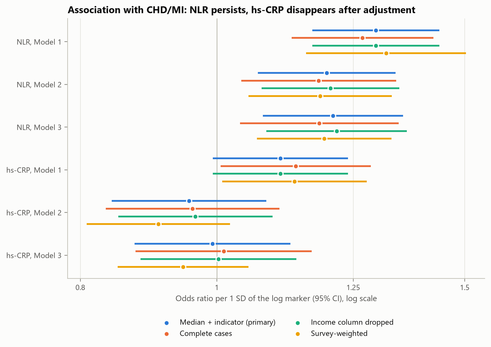
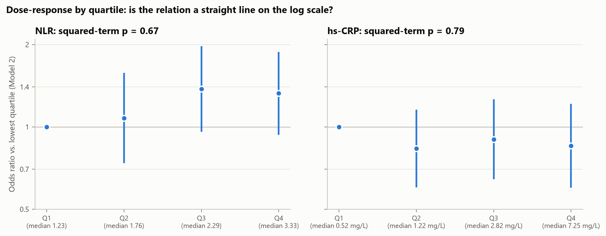

**So machst du es selbst:** `statsmodels.api.Logit(y, sm.add_constant(X)).fit()`, dann `.summary()` (Koeffizienten, Standardfehler, Wald-p), `np.exp(params)` für Odds Ratios, `res.llf` für die Log-Likelihood, `variance_inflation_factor` für den VIF.

**Prüffragen:**
- Wie liest man ein Odds Ratio von 1.20 pro SD?
- Warum ist Modell 2 und nicht Modell 3 das Hauptmodell?
- Was prüft der Likelihood-Ratio-Test, und warum ist er hier die passende Frage?
- Wie zeigt die Zerlegung, dass hs-CRP vor allem das Übergewicht widerspiegelt?

---

## Schritt 14 – Ergebnis der Zusatzfrage (H1c)

**Ziel:** Verbessern die Marker die Erkennung, bei irgendeinem Verfahren?

**Woher kommt die Erkennungskraft?** (logistische Regression, `fig12` A):

| Modell | AUC (95 %-KI) |
|---|---|
| M0 Alter, Geschlecht | 0.801 (0.782–0.820) |
| M1 + Ethnie, Einkommen, BMI | 0.815 (0.797–0.832) |
| M2 + klinische Risikofaktoren | 0.861 (0.839–0.884) |
| M3 + NLR, hs-CRP | 0.863 (0.840–0.885) |
| *M4 NLR + hs-CRP allein* | *0.631 (0.600–0.662)* |
| *NLR allein* | *0.633 (0.602–0.664)* |
| *hs-CRP allein* | *0.506 (0.462–0.550)* |

Schon Alter und Geschlecht erreichen 0.80. Die klinischen Faktoren bringen +0.046, die Marker +0.001. **Die Marker allein (M4) kommen nur auf 0.63**, und zwar ganz durch NLR (0.633). hs-CRP allein liegt mit 0.506 auf Zufallsniveau und verbessert auch NLR nicht. Das erklärt den fehlenden Zusatznutzen: NLR hat für sich ein schwaches Signal, das zu grossen Teilen schon in Alter und Risikofaktoren steckt; hs-CRP hat keines.

**Der Marker-Gewinn bei allen sechs Verfahren** (`main_marker_gain.csv`, `fig13`):

| Verfahren | AUC M2 | AUC M3 | ΔAUC M3 − M2 (95 %-KI) | p (Bonferroni) | ΔBrier |
|---|---|---|---|---|---|
| Logistische Regression | 0.861 | 0.863 | +0.0013 (-0.0009 bis +0.0035) | 1.00 | -0.0002 |
| Ridge/Lasso/Elastic Net | 0.862 | 0.863 | +0.0015 (-0.0008 bis +0.0038) | 1.00 | -0.0002 |
| Entscheidungsbaum | 0.808 | 0.805 | -0.0030 (-0.0123 bis +0.0064) | 1.00 | -0.0001 |
| k-nächste Nachbarn | 0.859 | 0.863 | +0.0039 (-0.0067 bis +0.0144) | 1.00 | +0.0000 |
| SVM (RBF) | 0.867 | 0.867 | +0.0003 (-0.0025 bis +0.0030) | 1.00 | -0.0003 |
| Random Forest | 0.856 | 0.859 | +0.0022 (-0.0055 bis +0.0099) | 1.00 | -0.0003 |

**H1c: nicht bestätigt.** Bei keinem Verfahren ist der Gewinn signifikant. Bei fünf der sechs liegt die obere Grenze des Konfidenzintervalls *unter 0.01*, also unter der Schwelle, die man oft als kleinste klinisch relevante Verbesserung der AUC ansieht. Ein relevanter Gewinn ist damit *ausgeschlossen*, nicht nur «nicht gezeigt». Nur bei kNN ist das Intervall dafür zu breit.

**Hängt es vom Verfahren ab?** Nein. Gegenüber der logistischen Regression ist kein Verfahren signifikant besser; die SVM liegt am höchsten (+0.004; 95 %-KI −0.002 bis +0.010; Bonferroni-p 0.74). Der Entscheidungsbaum ist signifikant schlechter (−0.058). Wichtig: «nicht signifikant besser» heisst nicht «gleich gut». Das Intervall der SVM reicht bis +0.010. Nach der vorher festgelegten Regel bleibt trotzdem **die logistische Regression das finale Modell**.

**Überanpassung** (W4; `fig14`): Lücke zwischen Trainings- und Test-AUC: logistische Regression 0.008, Elastic Net 0.007, SVM 0.019, Baum 0.033, Random Forest 0.093, kNN 0.137. Die kNN-Lücke ist ein Artefakt: Mit Distanzgewichtung ist jeder Trainingspunkt sein eigener nächster Nachbar, die Trainings-AUC ist also immer 1. Trotz der grossen Lücke ist der Random Forest auf neuen Daten nicht schlechter, weil seine Komplexität in der inneren CV eingestellt wurde.

**Kalibrierung** (`fig15`): Logistische Regression, Elastic Net und SVM sind gut kalibriert. Random Forest und kNN liefern zu vorsichtige Prozentzahlen (sie mitteln über viele Bäume bzw. Nachbarn), der Baum zu extreme.

**Bei einer konkreten Schwelle** (`main_threshold_metrics.csv`): Logistische Regression M3 erkennt 82.7 % der Kranken bei 75.0 % Spezifität (PPV 21.1 %, NPV 98.2 %); M2 erreicht praktisch dasselbe (82.2 % / 75.1 %).

**Lernkurven** (`fig24`): Ab etwa 2'500 Trainingspersonen bleibt die AUC flach. Mehr Daten derselben Art würden nichts ändern; die Grenze liegt in der Information der Variablen, nicht in der Stichprobengrösse.

**Welche Variablen zählen?** Permutation importance (`fig21`): Man mischt eine Variable zufällig und misst, wie stark die Test-AUC sinkt. Das funktioniert bei jedem Verfahren, im Gegensatz zur Baum-Wichtigkeit aus W7/W8. Bei allen sechs Verfahren dominiert das Alter, dann folgt das Cholesterin (Statin-Paradox). NLR liegt auf Rang 6–9 von 13, hs-CRP fast überall auf dem letzten Platz. Ein Baum der Tiefe 3 (`fig23`) fragt nach Alter, Diabetes, Cholesterin und Nierenfunktion und braucht keinen Marker.

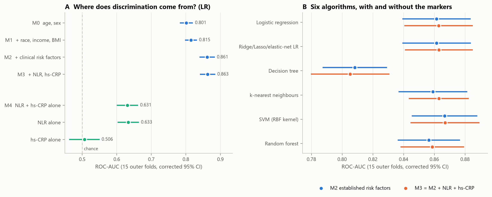
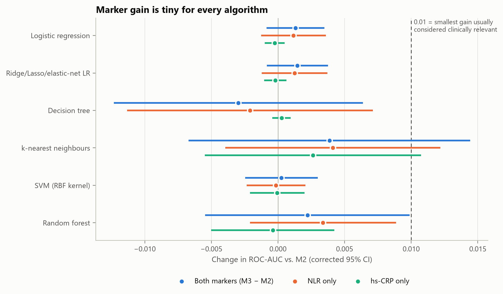

**Prüffragen:**
- Warum heisst «nicht signifikant» hier mehr als «wir wissen es nicht»?
- Warum ist die riesige kNN-Lücke kein Beweis für Überanpassung?
- Was sagt die flache Lernkurve über den Nutzen von mehr Daten?

---

## Schritt 15 – Sensitivitätsanalysen

**Ziel:** Zeigen, dass das Ergebnis nicht an einer einzelnen Entscheidung hängt.

Wir ändern jeweils *eine* Entscheidung und rechnen neu (`sensitivity_association.csv`, `sensitivity_prediction.csv`, `fig20`):

**Zusammenhang** (Odds Ratio pro SD):

| Variante | Fälle | NLR: OR (95 %-KI) | hs-CRP: OR (95 %-KI) |
|---|---:|---|---|
| Hauptanalyse (Modell 2) | 412 | 1.20 (1.07–1.34) | 0.96 (0.84–1.08) |
| Listwise deletion | 337 | 1.18 (1.04–1.34) | 0.96 (0.83–1.11) |
| Einkommen gelöscht | 412 | 1.20 (1.08–1.35) | 0.97 (0.85–1.10) |
| Modell 3 (+ Cholesterinsenker) | 412 | 1.21 (1.08–1.36) | 0.99 (0.87–1.13) |
| Survey-gewichtet | 412 | 1.18 (1.05–1.33) | 0.91 (0.81–1.02) |
| Outcome mit Angina | 457 | 1.14 (1.02–1.27) | 0.96 (0.85–1.08) |
| Nur Herzinfarkt | 237 | 1.28 (1.11–1.47) | 0.86 (0.73–1.01) |
| Nur KHK | 297 | 1.18 (1.03–1.34) | 1.00 (0.87–1.16) |
| Ohne hs-CRP > 10 mg/L | 381 | 1.19 (1.05–1.34) | 0.96 (0.82–1.12) |
| Ohne IQR-Ausreisser | 392 | 1.15 (1.01–1.30) | 0.94 (0.82–1.08) |
| Nur Unbehandelte | 96 | 1.21 (0.99–1.49) | 0.95 (0.74–1.22) |
| Alter 40–79 | 328 | 1.21 (1.06–1.37) | 0.96 (0.84–1.11) |
| NLR aus absoluten Zellzahlen | 412 | 1.20 (1.07–1.34) | 0.96 (0.84–1.08) |

NLR: OR zwischen 1.14 und 1.28; das Intervall schliesst 1 in 12 von 13 Varianten aus (Ausnahme: Nur Unbehandelte, wegen weniger Fälle). hs-CRP: OR zwischen 0.86 und 1.00, in keiner Variante signifikant.

**Erkennung** (logistische Regression, wiederholte CV):

| Variante | AUC M2 | AUC M3 | ΔAUC (95 %-KI) |
|---|---|---|---|
| Hauptanalyse | 0.861 | 0.863 | +0.0013 (-0.0009 bis +0.0035) |
| Outcome mit Angina | 0.848 | 0.849 | +0.0002 (-0.0022 bis +0.0026) |
| Nur Herzinfarkt | 0.864 | 0.869 | +0.0047 (-0.0007 bis +0.0101) |
| Nur KHK | 0.870 | 0.870 | +0.0001 (-0.0029 bis +0.0031) |
| Ohne hs-CRP > 10 mg/L | 0.864 | 0.864 | +0.0005 (-0.0020 bis +0.0031) |
| Ohne IQR-Ausreisser | 0.862 | 0.862 | +0.0002 (-0.0022 bis +0.0026) |
| Nur Unbehandelte | 0.837 | 0.833 | -0.0041 (-0.0119 bis +0.0037) |
| Alter 40–79 | 0.831 | 0.832 | +0.0006 (-0.0048 bis +0.0061) |
| Medikamente als Prädiktor | 0.875 | 0.876 | +0.0008 (-0.0014 bis +0.0030) |
| Ohne Cholesterin (durch Statine verzerrt) | 0.849 | 0.850 | +0.0017 (-0.0026 bis +0.0060) |

In keiner Variante ist der Gewinn signifikant. **Ohne Cholesterin** sinkt die AUC des Referenzmodells von 0.861 auf 0.849: So viel der Erkennungskraft kommt über das durch Statine veränderte Cholesterin. Der Marker-Gewinn bleibt aber klein (+0.0017).

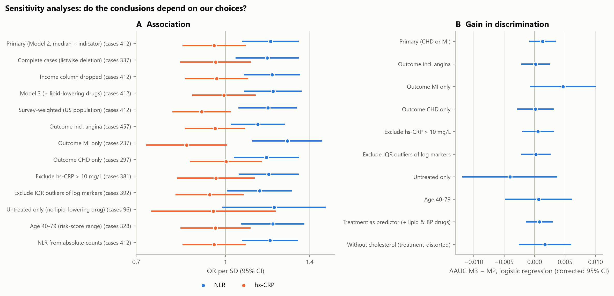

**Prüffragen:** Welche Sensitivitätsanalyse beantwortet welche mögliche Kritik?

---

## Schritt 16 – Interpretation und Grenzen

**Die Antwort:**
1. **NLR** hängt nach Adjustierung mit CHD/MI zusammen (H1a bestätigt), aber schwach. Zum Vergleich: Eine typische Schwankung im Alter (17 Jahre) mehr als verdoppelt die Chance (OR 2.6), im selben Modell.
2. **hs-CRP** hängt nicht zusammen (H1b nicht bestätigt). Der grobe Zusammenhang wird durch den BMI erklärt.
3. **Für die Erkennung** bringen beide praktisch nichts (H1c nicht bestätigt), bei keinem der sechs Verfahren.

**Warum «Zusammenhang» und «Erkennen» verschieden sind:** Ein Odds Ratio von 1.2 verschiebt die Risikoverteilungen von Kranken und Gesunden nur leicht. Ein Teil der NLR-Information steckt ausserdem schon in Alter, Diabetes, Rauchen und Nierenfunktion. Vergleich: Wer das Geburtsjahr kennt, gewinnt durch «hat graue Haare» kaum noch etwas, obwohl graue Haare echt mit dem Alter zusammenhängen.

**Grenzen:**

| Grenze | Folge | Was wir getan haben |
|---|---|---|
| Momentaufnahme | Ursache und Wirkung unklar | Frage als Zusammenhang formuliert |
| Selbstauskunft | Fehlklassifikation, unentdeckte Fälle fehlen | Drei Outcome-Varianten |
| Statine verändern Cholesterin und CRP | Verzerrung | Modell 3, «nur Unbehandelte», «ohne Cholesterin» |
| Eine einzige CRP-Messung | Zusammenhang wird unterschätzt | Ausschluss CRP > 10 mg/L |
| Ohne Blutprobe ausgeschlossen (499) | Eingeschränkte Übertragbarkeit | Mit SMD dokumentiert |
| Ungewichtete Hauptanalyse | Aussage gilt für die Stichprobe | Gewichtete Sensitivität |
| Nur interne Validierung | Übertragbarkeit auf andere Länder unklar | – |
| Zwei nachträgliche Schritte (SVM-Gewichte, Zerlegung) | Gefahr, Ergebnisse «hinzubiegen» | Offen gekennzeichnet, alte SVM-Ergebnisse archiviert |

---

## Schritt 17 – Checkliste zum Nachbauen

Wenn du es selbst aufbaust, geh in dieser Reihenfolge vor und kreuze ab:

- [ ] **Frage** schriftlich: Population, Exposition, Outcome, Vergleich; H0/H1; Bonferroni bei mehreren Hypothesen.
- [ ] **Stichprobe** mit Flussdiagramm (Personen *und* Fälle pro Schritt).
- [ ] **Variablen** bauen; Schiefe prüfen (Q-Q-Plot), log-Transformation begründen.
- [ ] **Table 1** mit Median [IQR] / n (%), Mann-Whitney / Chi-Quadrat + Bonferroni, SMD.
- [ ] **Fehlende Werte:** wie viele, wo, warum (MCAR/MAR/MNAR)? Drei Optionen vergleichen, Regel vorher festlegen.
- [ ] **Referenzmodell** aus der Literatur; Leck-Variablen (Behandlung, Folgediagnosen) ausschliessen.
- [ ] **Stichprobengrösse:** Fälle pro Parameter ≥ 10.
- [ ] **Ungleichgewicht:** Optionen inkl. SMOTE vergleichen; auf Kalibrierung achten.
- [ ] **Kreuzvalidierung:** wiederholt, stratifiziert, verschachtelt; *alles* Datenabhängige in die Pipeline.
- [ ] **Verfahren:** zuerst das einfache (logistische Regression), dann die komplexeren.
- [ ] **Masse:** AUC, PR-AUC, Kalibrierung, Brier, Konfusionsmatrix bei einer im Training gewählten Schwelle.
- [ ] **Vergleich:** gepaarter t-Test über Folds mit Korrektur, Bonferroni; Regel für das finale Modell vorher festlegen.
- [ ] **Hauptfrage:** logistische Regression (statsmodels), OR pro SD, Wald-p, LR-Test, VIF, Interaktionen.
- [ ] **Sensitivität:** jede wichtige Entscheidung einmal anders treffen.
- [ ] **Grenzen** ehrlich aufschreiben, nachträgliche Schritte kennzeichnen.

**Welche Datei macht was?**

| Datei | Inhalt |
|---|---|
| `config.py` | Alle Entscheidungen und Regeln an einem Ort |
| `common.py` | Pipeline, Modelle, Masse, Tests, SMOTE, Abbildungsstil |
| `01_prepare_data.py` | Bereinigung, Variablen, Stichprobe |
| `02_descriptives.py` | Table 1, fehlende Werte, Auswahl-Verzerrung, Stichprobengrösse |
| `03_design_experiments.py` | E1–E4 |
| `04_nested_cv.py` | Hauptanalyse der Erkennung (6 Verfahren × Feature-Sets) |
| `05_evaluate_models.py` | Tests, Tabellen, Abbildungen zur Erkennung |
| `06_association.py` | Hauptfrage: logistische Regression und Sensitivitätsanalysen |
| `07_interpretation.py` | Wichtigkeit, Was-wäre-wenn-Kurven, Baum, Lernkurven |
