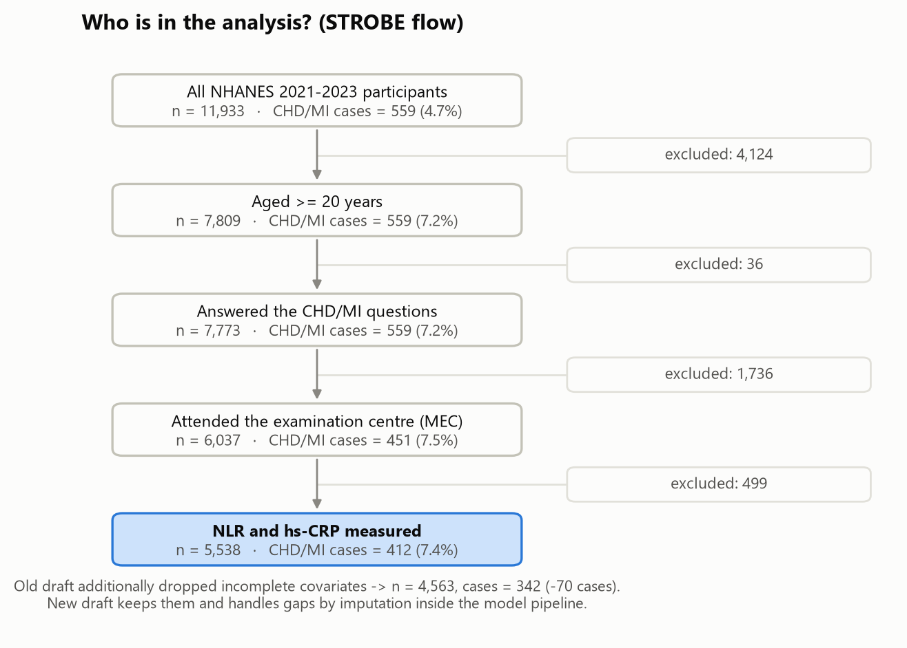
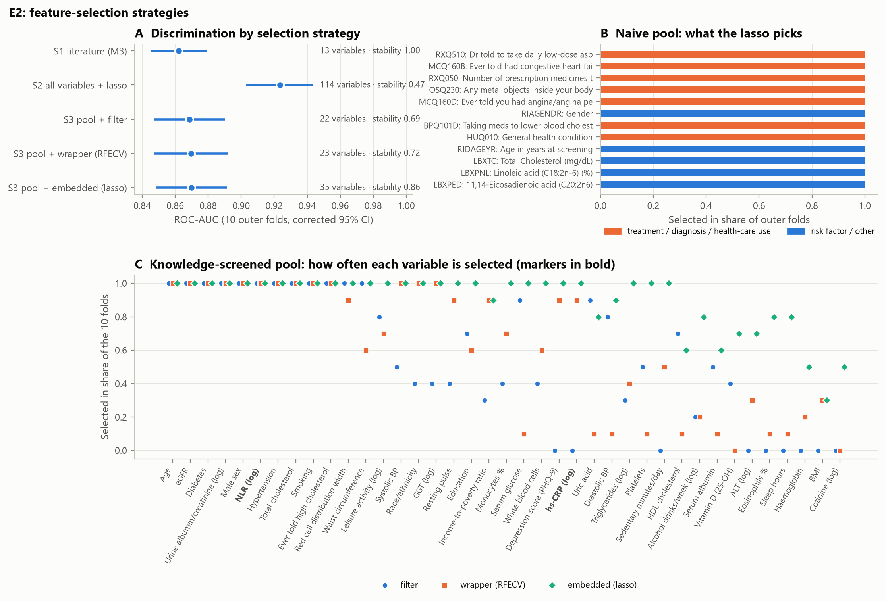
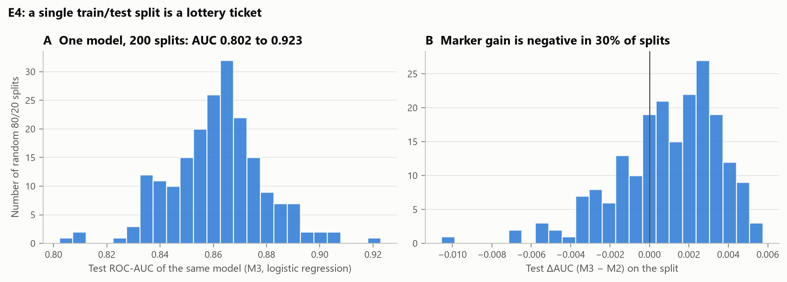
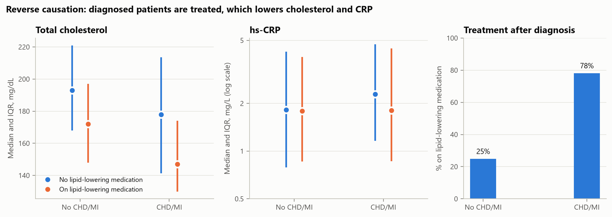
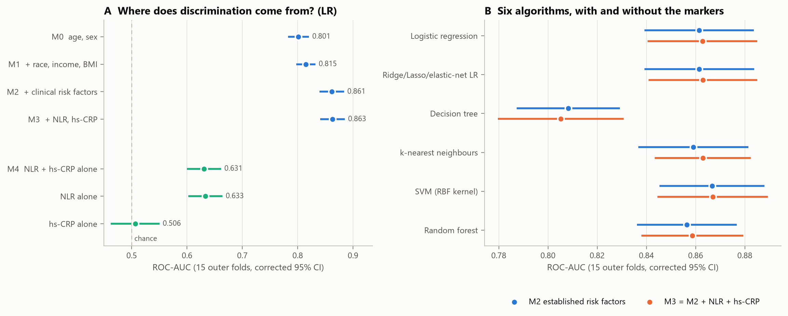
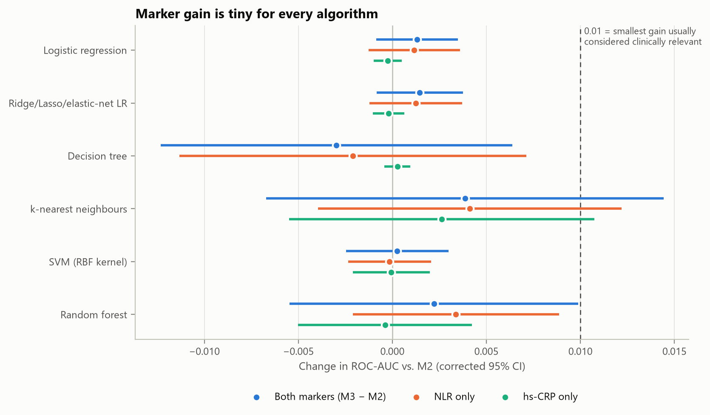
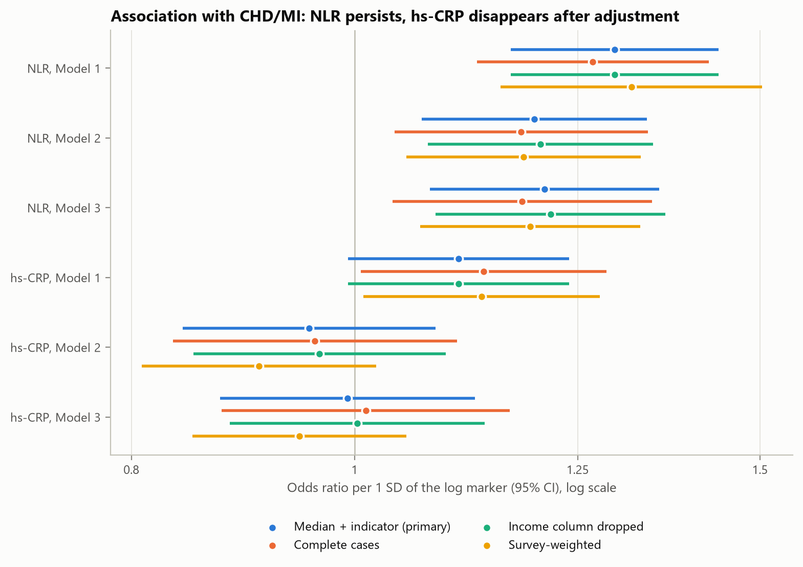

# Entzündungswerte im Blut und Herzkrankheit – einfach erklärt

*Begleittext zum Projekt «NLR, hs-CRP und koronare Herzkrankheit in NHANES 2021–2023» (ETH, Foundations of Data Science). Für Leserinnen und Leser ohne Statistik-Vorwissen. Die technische Fassung mit allen Details steht in [TECHNICAL_DOCUMENTATION.md](TECHNICAL_DOCUMENTATION.md).*

---

> **Das Wichtigste in fünf Sätzen**
>
> 1. Wir haben untersucht, ob zwei günstige Entzündungswerte aus dem Blut (NLR und hs-CRP) mit einer Herzkrankheit zusammenhängen, *wenn man die bekannten Risikofaktoren schon berücksichtigt*, und ob sie helfen, Menschen mit Herzkrankheit zu erkennen.
> 2. Dazu haben wir die Daten von 5'538 Erwachsenen aus einer grossen US-Gesundheitsstudie mit logistischer Regression und sechs Lernverfahren aus dem Kurs ausgewertet und fair getestet.
> 3. Ergebnis zum Zusammenhang: Die NLR hängt messbar mit der Herzkrankheit zusammen; hs-CRP tut das nach Berücksichtigung der anderen Faktoren nicht. Sein scheinbarer Zusammenhang wird vom Übergewicht erklärt.
> 4. Ergebnis zum Erkennen: Die beiden Blutwerte verbessern die Erkennung praktisch nicht, bei keinem der sechs Verfahren; die bekannten Risikofaktoren (vor allem das Alter) enthalten schon fast die ganze Information.
> 5. Jede Entscheidung auf dem Weg dorthin haben wir begründet: Für jeden Schritt wurden drei Möglichkeiten verglichen und die beste ausgewählt – teils mit Wissen aus der Forschung, teils mit einem eigenen kleinen Experiment.

---

## Inhalt

1. [Die Frage](#1-die-frage)
2. [Die Daten](#2-die-daten)
3. [Unsere Arbeitsweise: drei Möglichkeiten, eine begründete Wahl](#3-unsere-arbeitsweise-drei-möglichkeiten-eine-begründete-wahl)
4. [Die fünf wichtigsten Entscheidungen](#4-die-fünf-wichtigsten-entscheidungen)
5. [Sechs Lernverfahren](#5-sechs-lernverfahren)
6. [Wie misst man, ob ein Modell «gut» ist?](#6-wie-misst-man-ob-ein-modell-gut-ist)
7. [Die Ergebnisse](#7-die-ergebnisse)
8. [Was bedeutet das?](#8-was-bedeutet-das)
9. [Wo die Studie an Grenzen stösst](#9-wo-die-studie-an-grenzen-stösst)
10. [Was im Vergleich zum ersten Entwurf besser ist](#10-was-im-vergleich-zum-ersten-entwurf-besser-ist)
11. [Kleines Wörterbuch](#11-kleines-wörterbuch)

---

## 1. Die Frage

**Herzkrankheit und Entzündung.** Bei der koronaren Herzkrankheit (KHK) verengen sich die Herzkranzgefässe durch Ablagerungen; reisst eine solche Ablagerung auf, kann ein Herzinfarkt entstehen. Man weiss heute, dass dabei nicht nur Cholesterin, sondern auch eine schleichende Entzündung in der Gefässwand eine Rolle spielt.

**Die zwei Blutwerte.**

| Wert | Was er misst | Vergleich aus dem Alltag |
|---|---|---|
| **NLR** (Neutrophilen-Lymphozyten-Verhältnis) | Verhältnis zweier Sorten weisser Blutkörperchen: die «Feuerwehr» (Neutrophile) im Verhältnis zur «Spezialeinheit» (Lymphozyten). Bei Stress und Entzündung steigt das Verhältnis. | Wie viele Feuerwehrautos im Einsatz sind, im Verhältnis zur Polizei |
| **hs-CRP** (hochsensitives C-reaktives Protein) | Ein Eiweiss, das die Leber bei Entzündung ins Blut abgibt; «hochsensitiv» heisst, dass schon kleine Erhöhungen messbar sind. | Ein Rauchmelder, der schon bei wenig Rauch anschlägt – aber auch beim Toasten |

Beide Werte sind billig und fallen bei einem normalen Blutbild ohnehin an (NLR) bzw. sind einfach zu messen (hs-CRP).

**Unsere Hauptfrage:** *Hängen NLR und hs-CRP mit einer Herzkrankheit zusammen, wenn man die bekannten Risikofaktoren eines Menschen schon berücksichtigt (Alter, Geschlecht, Rauchen, Blutdruck, Diabetes, Cholesterin, Nierenfunktion usw.)?*

**Unsere Zusatzfrage:** *Kann man mit NLR und hs-CRP Menschen mit Herzkrankheit besser erkennen als mit den Risikofaktoren allein, und hängt die Antwort vom Lernverfahren ab?*

> **Vergleich:** Eine Detektivin hat schon elf Hinweise auf den Täter. Bringen zwei weitere Hinweise etwas Neues – oder sagen sie nur, was sie ohnehin schon weiss?

Dazu gehört eine zweite, kleinere Frage: *Hängen die Werte überhaupt mit der Herzkrankheit zusammen*, wenn man die anderen Faktoren berücksichtigt? Das ist nicht dasselbe – ein Hinweis kann echt sein und trotzdem nichts Neues verraten (siehe [Abschnitt 8](#8-was-bedeutet-das)).

---

## 2. Die Daten

**NHANES** (National Health and Nutrition Examination Survey) ist eine grosse Gesundheitsstudie der US-Gesundheitsbehörde. Die Teilnehmenden werden so ausgewählt, dass sie die US-Bevölkerung abbilden. Sie werden befragt, in einem mobilen Untersuchungszentrum untersucht und geben eine Blutprobe ab. Wir verwenden die Runde 2021–2023.

**Wer kommt in die Auswertung?** (siehe Abbildung `fig01_flowchart`)

| Schritt | Personen | davon mit Herzkrankheit |
|---|---:|---:|
| Alle Teilnehmenden 2021–2023 | 11'933 | 559 |
| Erwachsene (ab 20 Jahren) | 7'809 | 559 |
| Frage zur Herzkrankheit beantwortet | 7'773 | 559 |
| Im Untersuchungszentrum gewesen | 6'037 | 451 |
| **NLR und hs-CRP gemessen = unsere Stichprobe** | **5'538** | **412 (7.4 %)** |

**Was heisst hier «Herzkrankheit»?** Die Teilnehmenden wurden gefragt, ob ihnen eine Ärztin oder ein Arzt je gesagt hat, sie hätten eine koronare Herzkrankheit oder einen Herzinfarkt gehabt. Wer eines von beidem bejaht, zählt als «Fall».

**Wichtig – eine Momentaufnahme:** Blutwerte und Krankheit werden zur gleichen Zeit erfasst. Wir können deshalb nur sagen, ob die Werte eine *bestehende* Krankheit erkennen helfen – nicht, ob sie eine *zukünftige* vorhersagen. Und wir können nicht sagen, was zuerst da war (siehe [Abschnitt 9](#9-wo-die-studie-an-grenzen-stösst)).

---

## 3. Unsere Arbeitsweise: drei Möglichkeiten, eine begründete Wahl

Der erste Entwurf des Projekts hat viele Entscheidungen «einfach so» getroffen: Welche Merkmale ins Modell kommen, wer aus der Auswertung fliegt, wie getestet wird. Das ist gefährlich, weil jede dieser Entscheidungen das Ergebnis verändern kann – im schlimmsten Fall, ohne dass man es merkt.

Deshalb gilt in der neuen Fassung für **jede** Entscheidung dasselbe Vorgehen:

1. **Drei sinnvolle Möglichkeiten** aufschreiben.
2. **Kriterien festlegen**, *bevor* man die Ergebnisse kennt (z. B. «die einfachere Methode, ausser die kompliziertere ist um mindestens 0.005 besser»).
3. **Belegen:** mit Fachliteratur oder mit einem eigenen kleinen Experiment.
4. **Wählen** und das verbleibende Risiko offen benennen.

Insgesamt sind so 16 Entscheidungen dokumentiert (D1–D16 in der technischen Dokumentation). Vier davon wurden mit eigenen Experimenten entschieden (E1–E4). Die Methoden orientieren sich an den Vorlesungen des Kurses (Wochen 2–9).

> **Warum die Kriterien vorher festlegen?** Wer erst die Ergebnisse anschaut und dann die Regel wählt, findet fast immer eine Regel, die das gewünschte Ergebnis liefert. Das ist, als würde man beim Dartspielen zuerst werfen und dann die Zielscheibe um den Pfeil herum malen.

---

## 4. Die fünf wichtigsten Entscheidungen

### 4.1 Was tun mit fehlenden Angaben? (Experiment E1)

12.7 % der Teilnehmenden haben ihr Einkommen nicht angegeben, einigen fehlt ein Laborwert. Der erste Entwurf hat alle diese Menschen einfach gestrichen.

| Möglichkeit | Idee |
|---|---|
| A: Streichen | Nur wer alle Angaben hat, bleibt drin |
| B: Spalte löschen | Die Frage nach dem Einkommen ganz weglassen, alle Personen behalten |
| **C: Auffüllen + Vermerk** | **Fehlender Wert = typischer Wert (Median), plus eine Spalte «Angabe fehlte»** |

**Ergebnis:** Auffüllen behält **975 Menschen mehr, darunter 70 Herzkranke**, und die Modelle werden dadurch nicht schlechter (auf denselben Testpersonen sind alle drei Varianten praktisch gleich gut). Also nehmen wir C. Für die Zusammenhangs-Analyse rechnen wir alle drei Varianten durch; das Ergebnis ist in allen dasselbe.

Dass Streichen gefährlich ist, zeigt Abbildung `fig06_selection_bias`: Wer das Einkommen nicht angibt, ist im Schnitt ärmer und häufiger nicht weiss. Streicht man diese Menschen, wird die Stichprobe einseitiger.

> **Vergleich:** Fehlt auf einem Fragebogen eine einzige Antwort, wirft man nicht den ganzen Bogen weg.

### 4.2 Welche Merkmale kommen ins Modell? (Experiment E2)

| Möglichkeit | Idee |
|---|---|
| **A: Forschungswissen** | **Die Risikofaktoren, die in etablierten Herz-Risikorechnern stehen (z. B. Framingham, SCORE2, PCE)** |
| B: Der Computer wählt | Ein Verfahren (Lasso) wählt selbst aus allen 342 Variablen der Studie, die nicht zu oft fehlen |
| C: Kombination | Mit Fachwissen eine Vorauswahl von 39 Variablen, dann wählt der Computer |

**Das Warnbeispiel:** Lässt man den Computer frei aus allen Variablen wählen (B), wird das Modell scheinbar viel besser (AUC 0.92 statt 0.86). Aber was wählt er? «*Haben Sie Metallteile im Körper?*» (Herzpatienten haben Stents), «*Hat Ihnen ein Arzt geraten, täglich Aspirin zu nehmen?*», «*Anzahl verschriebener Medikamente*», «*Nehmen Sie Cholesterinsenker?*». Das sind keine Ursachen der Krankheit, sondern **Folgen der Diagnose**. Ein solches Modell «erkennt» die Krankheit, weil es heimlich die Behandlung sieht – das nennt man **Datenleck** (englisch *leakage*). Für eine echte Anwendung ist es wertlos.

**Ergebnis:** Die Kombination C ist nur minimal besser als das Forschungswissen (+0.008), aber weniger stabil (je nach Datenteilung werden andere Variablen gewählt). Wir nehmen deshalb A für die Hauptanalyse – es ist durchschaubar, stabil und entspricht dem, was in der Praxis tatsächlich verwendet wird. Interessant: Die NLR wurde von *jeder* Computer-Auswahl gewählt, hs-CRP nur von manchen.

### 4.3 Die Krankheit ist selten – ausgleichen oder nicht? (Experiment E3)

Nur 7.4 % der Menschen sind herzkrank. Viele Lehrbücher empfehlen, das «auszugleichen», z. B. indem man die Kranken im Training künstlich vervielfacht.

**Das Genauigkeits-Paradox:** Ein «Modell», das einfach *immer* «gesund» sagt, liegt in 92.6 % der Fälle richtig – und findet keinen einzigen Kranken. «Genauigkeit» ist bei seltenen Krankheiten deshalb ein irreführendes Mass.

| Möglichkeit | Idee |
|---|---|
| **A: Nicht ausgleichen** | **Natürliche Häufigkeit behalten, dafür die Entscheidungsschwelle bewusst wählen** |
| B: Gewichten | Jeder Kranke zählt im Training ~12-mal |
| C: Vervielfachen / Weglassen | Kranke kopieren oder Gesunde weglassen |
| D: SMOTE | Neue, künstliche Kranke «zwischen» echten Kranken erzeugen |

**Ergebnis:** Ausgleichen verbessert die Unterscheidung zwischen Kranken und Gesunden **nicht**, macht aber die Risikowerte falsch: Das Modell behauptet dann im Schnitt 22–38 % Risiko, obwohl die echte Häufigkeit 7.4 % ist. Das gilt auch für SMOTE. Wer nur die Schwelle tiefer setzt, erreicht dieselbe Trefferquote bei Kranken (rund 82 %) – mit ehrlichen Risikowerten. Also A.

*Eine Ausnahme haben wir nachträglich entdeckt und offen dokumentiert:* Die Support-Vector-Maschine (eines der sechs Verfahren) bricht ohne Ausgleich zusammen, weil sie bei seltenen Fällen die bequeme Lösung «alle gesund» bevorzugt. Bei ihr werden die Risikowerte ohnehin nachträglich neu geeicht, deshalb schadet der Ausgleich dort nicht. Sie bekommt ihn darum.

### 4.4 Wie testet man fair? (Experiment E4)

Der erste Entwurf hat die Daten einmal zufällig in 80 % «Lernen» und 20 % «Prüfen» geteilt.

**Das Lotterie-Problem:** Wir haben dasselbe Modell 200-mal mit verschiedenen Zufallsteilungen geprüft. Die Note (AUC) schwankte zwischen **0.80 und 0.92** – nur wegen des Zufalls. In **30 %** der Teilungen sah es sogar so aus, als würden die Blutwerte *schaden*. Eine einzige Teilung ist also eine Lotterie.

**Lösung:** Wiederholte Kreuzvalidierung. Die Daten werden in 5 gleich grosse Teile geteilt; jeder Teil ist einmal «Prüfung», die anderen vier sind «Lernstoff». Das Ganze wird mit drei verschiedenen Zufallsteilungen wiederholt → **15 Prüfungen**. Jeder Mensch wird so dreimal geprüft, und zwar immer von einem Modell, das ihn nie gesehen hat. Die Einstellungen der Verfahren werden *innerhalb* des Lernstoffs festgelegt (verschachtelte Kreuzvalidierung), damit die Prüfung nicht heimlich mitlernt.

> **Vergleich:** Statt eine Schülerin mit einer einzigen Prüfung zu bewerten, nimmt man den Durchschnitt aus 15 Prüfungen – und keine Prüfungsfrage darf vorher im Unterricht vorgekommen sein.

### 4.5 Das Statin-Paradox: warum Behandlungen die Daten verzerren

Herzkranke haben in unseren Daten **tieferes** Cholesterin als Gesunde (Median 152 statt 187 mg/dL). Das heisst nicht, dass Cholesterin schützt: **78 % der Herzkranken nehmen Cholesterinsenker** (Statine), aber nur 25 % der übrigen. Die Diagnose führt zur Behandlung, die Behandlung senkt den Wert. Statine senken übrigens auch hs-CRP.

Wir haben drei Möglichkeiten verglichen, damit umzugehen (Behandlung ignorieren, Behandlung als Merkmal ins Modell nehmen, nur Unbehandelte analysieren) und alle drei durchgerechnet. Der fehlende Zusatznutzen der Blutwerte zeigt sich in allen drei Varianten. Der Zusammenhang der NLR mit der Krankheit ist bei den Unbehandelten gleich gross (Odds Ratio 1.21), wegen nur 96 Fällen aber statistisch unsicher.

---

## 5. Sechs Lernverfahren

Ein «Lernverfahren» ist ein Rezept, mit dem der Computer aus Beispielen eine Regel ableitet: «Bei diesen Merkmalen ist das Risiko so hoch.» Wir haben die sechs Verfahren aus dem Kurs verwendet:

| Verfahren | So funktioniert es (vereinfacht) | Vergleich |
|---|---|---|
| **Logistische Regression** | Jeder Risikofaktor bekommt Punkte; die Summe wird in ein Risiko umgerechnet. | Ein Punkteformular beim Arzt |
| **Ridge / Lasso** | Wie oben, aber mit «Sparsamkeits-Strafe»: unwichtige Faktoren bekommen weniger oder keine Punkte. | Ein Punkteformular, bei dem überflüssige Fragen gestrichen werden |
| **Entscheidungsbaum** | Eine Kette von Ja/Nein-Fragen («Älter als 60? Raucher?»). | Ein Flussdiagramm |
| **k-nächste Nachbarn** | Schaut die ähnlichsten Menschen in den Daten an und nimmt deren Krankheitsanteil. | «Sag mir, wer dir ähnlich ist …» |
| **Support-Vector-Maschine** | Sucht eine (gekrümmte) Grenze, die Kranke und Gesunde mit möglichst viel Abstand trennt. | Eine Strasse mit möglichst breitem Mittelstreifen |
| **Random Forest** | Hunderte leicht verschiedene Entscheidungsbäume stimmen ab. | Die Weisheit der Vielen |

Jedes Verfahren wurde mit und ohne die beiden Blutwerte trainiert und auf genau dieselben 15 Prüfungen angesetzt. So ist der Vergleich fair.

---

## 6. Wie misst man, ob ein Modell «gut» ist?

**AUC – die wichtigste Zahl.** Man nimmt zufällig eine kranke und eine gesunde Person. Die AUC ist die Wahrscheinlichkeit, dass das Modell der kranken Person das höhere Risiko gibt.

| AUC | Bedeutung |
|---|---|
| 0.5 | Münzwurf – das Modell kann nichts |
| 0.7 | brauchbar |
| 0.8 | gut |
| 0.9 | sehr gut |
| 1.0 | perfekt (in der Medizin praktisch nie) |

**Kalibrierung – stimmen die Risikowerte?** Wenn das Modell 100 Menschen je 10 % Risiko gibt, sollten etwa 10 davon tatsächlich krank sein. Ein Modell kann gut unterscheiden und trotzdem falsche Prozentzahlen nennen (siehe 4.3).

**Statistische Tests.** Weil die 15 Prüfungen auf überlappenden Lerndaten beruhen, sind sie nicht unabhängig; ein normaler gepaarter t-Test wäre zu optimistisch. Wir verwenden deshalb eine dafür korrigierte Version (Nadeau & Bengio) und korrigieren zusätzlich dafür, dass wir viele Vergleiche machen (Bonferroni-Korrektur: jeder p-Wert wird mit der Anzahl Tests multipliziert).

---

## 7. Die Ergebnisse

### 7.1 Woher kommt die Erkennungskraft?

Wir haben die Merkmale schrittweise hinzugefügt (logistische Regression):

| Modell | Merkmale | AUC |
|---|---|---:|
| M0 | Alter, Geschlecht | 0.80 |
| M1 | + Herkunft, Einkommen, BMI | 0.81 |
| M2 | + Rauchen, Diabetes, Blutdruck, Cholesterin, HDL, Nierenfunktion | 0.86 |
| **M3** | **+ NLR und hs-CRP** | **0.86** (+0.001) |
| *M4* | *nur NLR und hs-CRP, ohne alle anderen Merkmale* | *0.63* |
| | *nur NLR* | *0.63* |
| | *nur hs-CRP* | *0.51 (Münzwurf)* |

**Schon Alter und Geschlecht allein erreichen 0.80.** Die klassischen Risikofaktoren bringen weitere 0.05. Die beiden Blutwerte bringen **+0.001** – das ist innerhalb der Zufallsschwankung (statistisch nicht gesichert).

### 7.2 Liegt es am Verfahren?

Nein. **Bei allen sechs Verfahren** ist der Zusatznutzen der Blutwerte winzig (Abbildung `fig13_marker_gain`). Auch flexible Verfahren wie Random Forest, kNN oder die SVM, die versteckte Muster und Wechselwirkungen finden könnten, finden keinen nennenswerten Mehrwert.

Die komplizierten Verfahren sind zudem **nicht nachweislich besser** als die einfache logistische Regression. Die Support-Vector-Maschine liegt zwar minimal höher (0.867 statt 0.863), aber dieser Unterschied ist kleiner als die Zufallsschwankung. Nach unserer vorher festgelegten Regel («das einfachste Verfahren, ausser ein anderes ist nachweislich besser») empfehlen wir deshalb die logistische Regression. Der einzelne Entscheidungsbaum ist deutlich schwächer (AUC ≈ 0.81), dafür aber am leichtesten zu lesen: Er fragt zuerst nach dem Alter (über 65?), dann nach Diabetes bzw. Cholesterin und Nierenfunktion. Die Blutwerte kommen in ihm gar nicht vor (Abbildung `fig23_decision_tree`).

### 7.3 Hängen die Werte trotzdem mit der Krankheit zusammen?

Hier unterscheiden sich die beiden Werte deutlich:

| | ohne Berücksichtigung anderer Faktoren | nach Berücksichtigung aller Risikofaktoren |
|---|---|---|
| **NLR** | Herzkranke haben höhere Werte (Median 2.39 vs. 1.96) | **pro typischer Schwankung (1 Standardabweichung) ~20 % höhere Chance**, herzkrank zu sein (Odds Ratio 1.20; 95 %-Bereich 1.07–1.34) |
| **hs-CRP** | praktisch kein Unterschied (1.97 vs. 1.81 mg/L) | **kein Zusammenhang** (Odds Ratio 0.96; 95 %-Bereich 0.84–1.08) |

Beide Zahlen stammen aus dem Hauptmodell (alle etablierten Risikofaktoren berücksichtigt). Weil wir zwei Hypothesen gleichzeitig prüfen, muss jeder p-Wert unter 0.025 liegen (Bonferroni). Bei NLR ist p = 0.002, bei hs-CRP p = 0.48.

Der NLR-Zusammenhang ist robust: Er bleibt bestehen, wenn man nur Herzinfarkte zählt, Angina pectoris dazunimmt, extreme Werte entfernt, nur 40–79-Jährige betrachtet oder die Stichprobe nach US-Bevölkerung gewichtet (Abbildung `fig20_sensitivity`). Nur bei den Unbehandelten (96 Fälle) ist er zwar gleich gross, aber nicht mehr gesichert. hs-CRP zeigt in keiner einzigen Variante einen Zusammenhang.

---

## 8. Was bedeutet das?

**«Zusammenhang» ist nicht dasselbe wie «hilft beim Erkennen».** Die NLR hängt echt mit der Herzkrankheit zusammen, verbessert die Erkennung aber kaum. Wie geht das zusammen?

> **Vergleich:** Stellen Sie sich vor, Sie sollen erraten, wer in einem Raum über 70 ist. Sie kennen bereits das Geburtsjahr aller Personen. Jetzt bekommen Sie zusätzlich die Information, wer graue Haare hat. Graue Haare hängen *echt* mit dem Alter zusammen – aber sie helfen Ihnen kaum noch, weil Sie das Geburtsjahr schon kennen.

Ähnlich hier: Die NLR ist ein schwacher Hinweis, und ein Teil davon steckt schon in Alter, Diabetes, Rauchen und Nierenfunktion. Ein Odds Ratio von 1.2 klingt nach viel, ist aber für das Erkennen einzelner Menschen wenig. Zum Vergleich auf derselben Skala: Eine typische Schwankung im Alter (17 Jahre) **mehr als verdoppelt** die Chance auf eine Herzkrankheit (Odds Ratio 2.6), und zwar auch dann, wenn alle anderen Faktoren schon berücksichtigt sind.

**Warum zeigt hs-CRP keinen Zusammenhang?** Mögliche Gründe, die sich mit unseren Daten nicht abschliessend klären lassen:

- **Behandlung und andere Risikofaktoren:** Statine senken hs-CRP – und 78 % der Herzkranken nehmen sie. Bei den *Unbehandelten* haben Herzkranke tatsächlich höhere hs-CRP-Werte (Median 2.3 vs. 1.8 mg/L, Abbildung `fig03`). Dieser Unterschied verschwindet aber vollständig, sobald man das Körpergewicht (BMI) berücksichtigt: Menschen mit Übergewicht haben mehr hs-CRP im Blut *und* sind häufiger herzkrank. hs-CRP misst hier also vor allem das Übergewicht mit, und das kennt das Modell ohnehin schon. Umgekehrt wird der Zusammenhang etwas *stärker*, wenn man nur die Statin-Einnahme berücksichtigt; die Medikamente verdecken also einen Teil des Signals.
- **Momentaufnahme:** hs-CRP schwankt stark (jede Erkältung lässt ihn steigen). Eine einzelne Messung ist ein unscharfes Bild.
- **Die Frage ist anders:** Studien, die hs-CRP als Risikofaktor zeigen, beobachten Menschen *über Jahre* und sagen künftige Herzinfarkte voraus. Wir erkennen eine schon bestehende Krankheit.

**Für die Praxis** würde unser Ergebnis bedeuten: Wer die klassischen Risikofaktoren kennt, gewinnt mit NLR und hs-CRP für die *Erkennung* einer bestehenden Herzkrankheit praktisch nichts dazu. Über ihren Nutzen für die *Vorhersage* künftiger Ereignisse sagt unsere Studie nichts.

---

## 9. Wo die Studie an Grenzen stösst

Eine ehrliche Arbeit benennt ihre Schwächen. Die wichtigsten:

1. **Momentaufnahme (Querschnitt).** Wir wissen nicht, ob die Entzündung zur Krankheit führte oder die Krankheit (bzw. ein Infarkt oder eine Operation) zur Entzündung.
2. **Selbstauskunft.** «Herzkrankheit» heisst: Die Person erinnert sich an eine entsprechende Diagnose. Manche irren sich, manche wissen nichts von ihrer Krankheit.
3. **Behandlung verzerrt die Werte** (Statin-Paradox). Wir haben drei Varianten gerechnet; ganz auflösen lässt sich das in Querschnittsdaten nicht.
4. **Nur ein Land, eine Zeit.** Die Ergebnisse gelten für die USA 2021–2023 und müssten anderswo bestätigt werden.
5. **Fehlende Blutwerte.** Wer keine Blutprobe hat, fehlt (499 Personen). Diese Gruppe unterscheidet sich etwas (z. B. ärmer); das ist in `fig06_selection_bias` dokumentiert.
6. **Seltene Fälle.** 412 Herzkranke reichen für unsere Modelle (Faustregel: mindestens 10 Fälle pro Modellparameter; wir haben 19 Parameter, also rund 22 Fälle pro Parameter), aber kleine Effekte bleiben unsicher.

---

## 10. Was im Vergleich zum ersten Entwurf besser ist

| Erster Entwurf | Neue Fassung |
|---|---|
| Merkmale ohne Begründung gewählt | Merkmale aus etablierten Risikorechnern; drei Strategien im Experiment verglichen; Datenleck nachgewiesen |
| Menschen mit fehlenden Angaben gestrichen | Fehlende Werte aufgefüllt (+975 Menschen, +70 Kranke); Auswirkung im Experiment geprüft |
| Ein einziger 80/20-Test (Lotterie) | 15 Prüfungen mit verschachtelter Kreuzvalidierung |
| Vergleich «nach Augenmass» | Korrigierte statistische Tests mit Mehrfachtest-Korrektur |
| Wenige Verfahren | Alle sechs Verfahren des Kurses, mit gleichem Prüfverfahren |
| Nur Unterscheidung gemessen | Zusätzlich Kalibrierung, klinischer Nutzen, Schwellenwerte |
| Behandlung nicht beachtet | Statin-Paradox erkannt; drei Varianten gerechnet |
| Ergebnisse nicht hinterfragt | Rund zehn Sensitivitätsanalysen; Grenzen offen benannt |

---

## 11. Kleines Wörterbuch

| Begriff | Erklärung |
|---|---|
| **AUC** | Wahrscheinlichkeit, dass das Modell einer zufällig gewählten kranken Person ein höheres Risiko gibt als einer zufällig gewählten gesunden. 0.5 = Zufall, 1 = perfekt. |
| **Datenleck (Leakage)** | Das Modell sieht heimlich Information, die es in der Praxis nicht hätte (z. B. die Behandlung als Folge der Diagnose). Ergebnis: scheinbar gute, in Wahrheit wertlose Modelle. |
| **Kalibrierung** | Ob die genannten Prozentzahlen stimmen (10 % Risiko → 10 von 100 krank). |
| **Kreuzvalidierung** | Die Daten werden in Teile zerlegt; jeder Teil wird einmal zum Prüfen verwendet, der Rest zum Lernen. |
| **Verschachtelte Kreuzvalidierung** | Zusätzlich werden die Einstellungen eines Verfahrens nur mit den Lerndaten bestimmt – die Prüfdaten bleiben völlig unberührt. |
| **Imputation** | Fehlende Werte sinnvoll auffüllen (z. B. mit dem Median), statt die Person zu streichen. |
| **Odds Ratio (OR)** | Um welchen Faktor sich die Chance auf die Krankheit ändert. OR 1.2 = 20 % höhere Chance; OR 1 = kein Zusammenhang. |
| **95 %-Konfidenzintervall** | Bereich, in dem der wahre Wert mit hoher Sicherheit liegt. Enthält er 1 (bei OR) bzw. 0 (bei Differenzen), ist der Effekt nicht gesichert. |
| **p-Wert** | Wie überraschend das Ergebnis wäre, wenn es in Wahrheit keinen Effekt gäbe. Klein (unter 0.05) = überraschend = Hinweis auf einen echten Effekt. |
| **Überanpassung (Overfitting)** | Das Modell lernt die Trainingsdaten auswendig, inklusive Zufall, und ist bei neuen Daten schlechter. Erkennbar am Unterschied zwischen Trainings- und Prüfleistung. |
| **Sensitivität / Spezifität** | Anteil der Kranken, die erkannt werden / Anteil der Gesunden, die korrekt als gesund eingestuft werden. |
| **Statin** | Medikament, das Cholesterin (und nebenbei hs-CRP) senkt. |
| **Standardabweichung (SD)** | Typische Schwankung eines Wertes um seinen Durchschnitt. |
