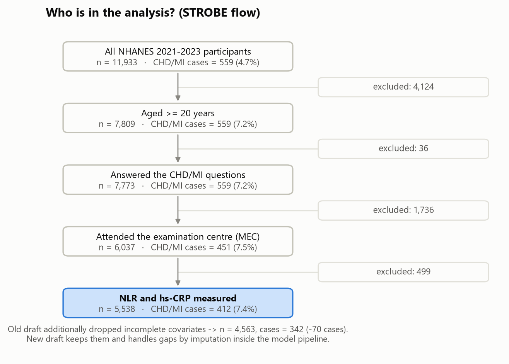
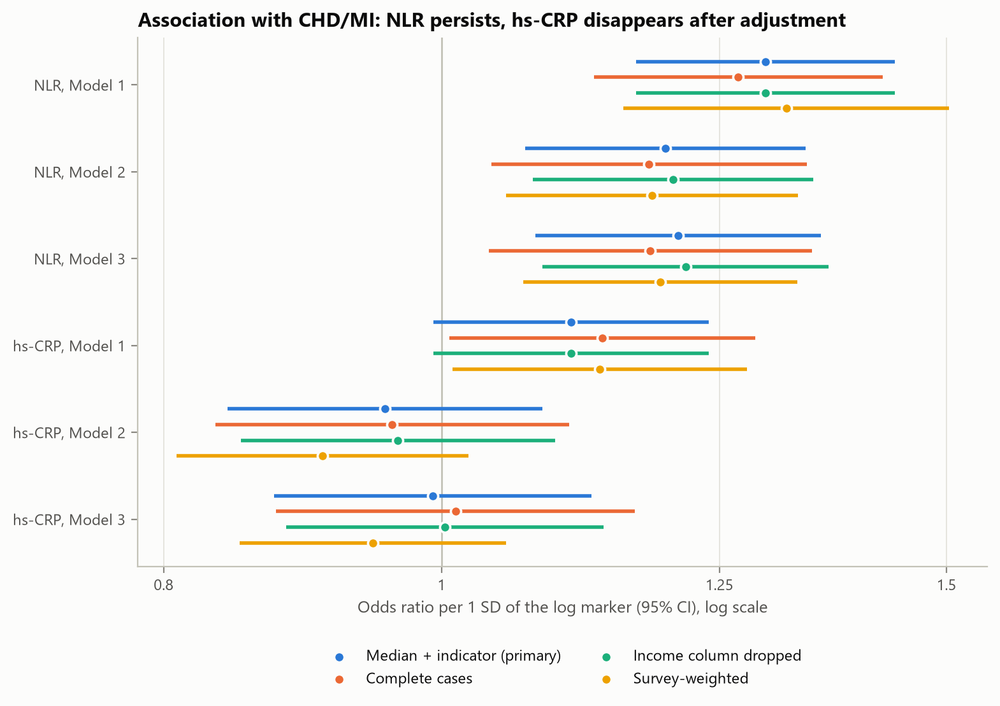
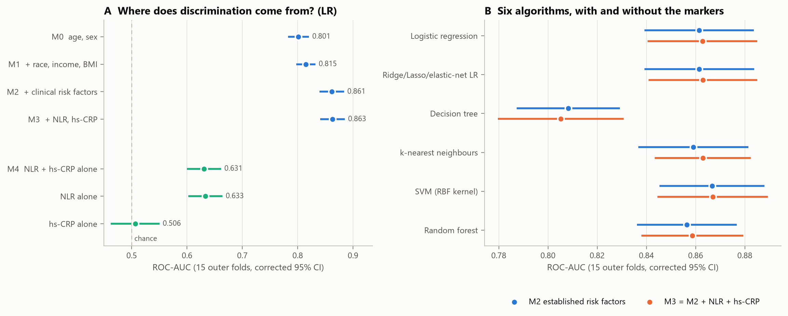
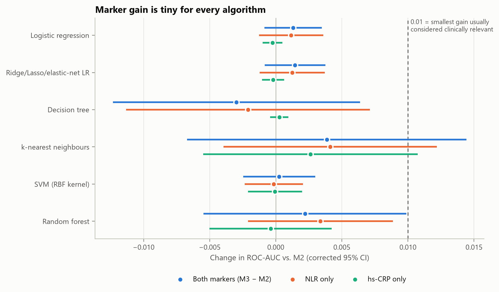
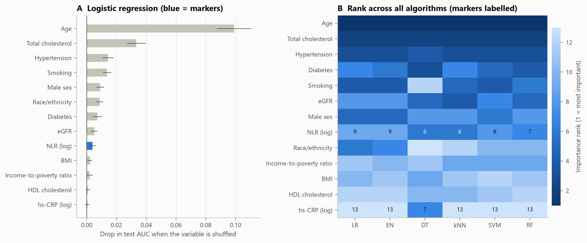
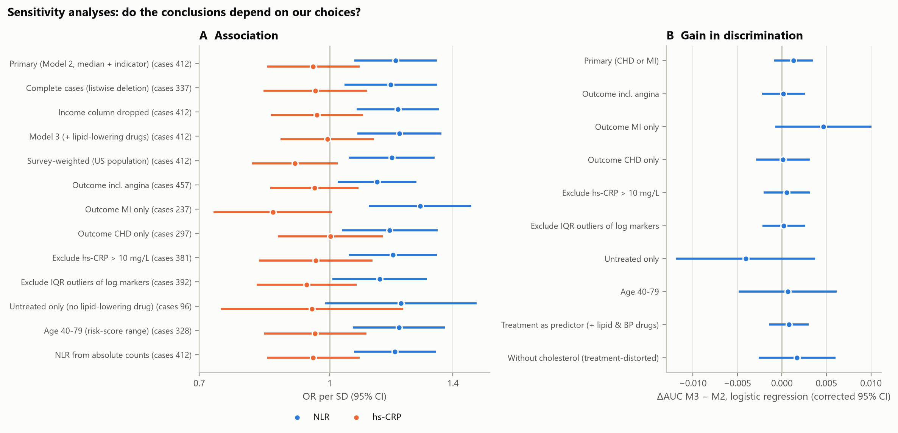

# Inflammation markers and coronary heart disease in NHANES 2021–2023: association and added discrimination

*Foundations of Data Science, ETH Zürich, group project (Dataset 5). Draft.*

---

## Abstract

**Background.** Two inexpensive blood markers of systemic inflammation, the neutrophil-to-lymphocyte ratio (NLR) and high-sensitivity C-reactive protein (hs-CRP), have been proposed as markers of coronary heart disease (CHD). We asked whether they are associated with CHD beyond established risk factors and whether they improve its discrimination, using several machine-learning (ML) methods.

**Methods.** Cross-sectional analysis of 5,538 adults with both markers measured (412 with self-reported CHD or myocardial infarction, 7.4%). Every analytical choice compared three options against a rule written down before the analysis. The association was estimated by logistic regression (odds ratio per SD of the log marker; Bonferroni for the two co-primary markers). Discrimination was compared for six algorithms with and without the markers in repeated nested cross-validation (15 test folds).

**Results.** After adjustment for established risk factors, NLR was associated with CHD/MI (OR 1.20, 95% CI 1.07–1.34, p = 0.002); hs-CRP was not (OR 0.96, 0.84–1.08, p = 0.48). The crude hs-CRP association was accounted for by body-mass index. Established risk factors discriminated well (logistic regression AUC 0.861), and adding both markers changed the AUC by +0.001 (95% CI −0.001 to +0.004). No algorithm showed a significant gain or outperformed logistic regression. The findings held in 13 sensitivity analyses.

**Conclusion.** NLR carries a modest adjusted association with CHD/MI, hs-CRP none; on their own the markers discriminate weakly (AUC 0.63), and neither improves the discrimination of prevalent disease beyond established risk factors, whatever the learning algorithm.

---

## 1. Introduction

Ischaemic heart disease is the leading cause of death worldwide (WHO 2024). Its established risk factors (age, sex, smoking, blood pressure, diabetes, cholesterol and kidney function) form the basis of clinical risk scores such as the Pooled Cohort Equations, SCORE2 and PREVENT (Goff et al. 2014; SCORE2 working group 2021; Khan et al. 2024). Atherosclerosis is also an inflammatory process: in the CANTOS trial, lowering inflammation without lowering cholesterol reduced cardiovascular events (Ridker et al. 2017).

Two markers summarise systemic inflammation cheaply. **hs-CRP** is associated with CHD in large cohorts (Emerging Risk Factors Collaboration 2010), but adds little to risk prediction (C-index +0.004; ERFC 2012), and Mendelian-randomisation evidence argues against a causal role (CCGC 2011). **NLR** comes with every differential blood count and is associated with atherosclerotic events in trial populations (Adamstein et al. 2021); its relation to CHD in the general population is less well described.

Whether a marker adds information may also depend on the method. Flexible ML algorithms can capture non-linear effects and interactions that logistic regression misses. Comparisons based on a single train–test split are fragile, however: in our data, the AUC of the same model varied between 0.80 and 0.92 across 200 random splits.

**Research question.** Among US adults, are higher NLR and hs-CRP associated with a self-reported history of CHD or myocardial infarction (CHD/MI), independent of established cardiovascular risk factors?

- **H1a:** NLR is associated with CHD/MI after adjustment.
- **H1b:** hs-CRP is associated with CHD/MI after adjustment.
- **H1c (secondary):** NLR and hs-CRP improve the discrimination of CHD/MI beyond established risk factors, and this does not depend on the learning algorithm.

Because NHANES 2021–2023 is cross-sectional, the outcome is *existing* disease, and the study can establish association, not causation or prediction of future events. H1c is therefore a necessary condition rather than a clinical application: a marker that does not even improve the identification of existing disease is unlikely to be useful for screening.

---

## 2. Methods

### 2.1 Data and study population

NHANES is a stratified, multistage probability sample of the US civilian population with interviews, a physical examination in a mobile examination centre (MEC) and laboratory tests; protocols were approved by the NCHS Research Ethics Review Board and the data are public. Of 11,933 participants in 2021–2023, we included adults (≥ 20 years) who answered the CHD/MI questions, attended the MEC and had NLR and hs-CRP measured (n = 5,538; Figure 1). Analyses are unweighted and describe this sample; survey weights were used in a sensitivity analysis.

**Outcome.** "Has a doctor ever told you that you had coronary heart disease / a heart attack?" (MCQ160C or MCQ160E): 412 cases (7.4%). Variants (MI only, CHD only, including angina) were used in sensitivity analyses.

**Markers.** NLR = neutrophils / lymphocytes; hs-CRP in mg/L. Both are strongly right-skewed (skewness 4.66 and 7.78) and were log-transformed (0.15 and 0.23; Q-Q plots). Effects are reported per 1 SD of the log marker: a factor of 1.58 for NLR and 3.15 for hs-CRP on the original scale.

**Established risk factors** (from the Pooled Cohort Equations, SCORE2, QRISK3, PREVENT and INTERHEART): age, sex, race/ethnicity, income-to-poverty ratio, BMI, smoking (never/former/current), diabetes, hypertension (diagnosed or ≥ 140/90 mmHg), total and HDL cholesterol, and eGFR (CKD-EPI 2021, without race).

### 2.2 Decision protocol

For every analytical decision we compared three (or, where the course taught more, all) options against a criterion written into the analysis code before the corresponding experiment was run; the protocol was not publicly registered. Four decisions were settled by dedicated experiments (Table 1). Two later changes are marked as post hoc: class weights for the support-vector machine (Section 2.4) and an exploratory decomposition of the hs-CRP association (Section 3.2).

**Table 1. Design experiments: options, rule and result.**

| Decision | Options | Rule (written down beforehand) | Result | Choice |
|---|---|---|---|---|
| E1 Missing covariates (income 12.7% missing) | listwise deletion · drop income column · median imputation + missing indicator | keep everybody (median + indicator) unless an alternative is > 0.005 AUC better on the same test persons | AUC on the same persons 0.866 / 0.867 / 0.867; imputation keeps 975 persons (70 cases) | median + indicator |
| E2 Feature selection | literature set · all 342 variables + lasso · knowledge-screened pool of 39 + filter / wrapper / lasso | reference set is fixed by the research question; E2 checks for leakage and for marker selection | naive lasso AUC 0.923 only through leakage (stents, aspirin advice, heart failure); hybrid +0.008, less stable; NLR selected in every fold | literature set |
| E3 Class imbalance (7.4% cases) | none · class weights · over- · undersampling · SMOTE | correction only if AUC +0.005 without a worse Brier score | AUC 0.856–0.863 for all; Brier 0.058 → 0.094–0.167; mean predicted risk 22–38% instead of 7.4% | none |
| E4 Evaluation design | single 80/20 split · cross-validation · repeated nested CV | – (variance of a single split measured) | same model on 200 splits: AUC 0.80–0.92; marker gain < 0 in 29.5% of splits | repeated nested CV |

Missing values were handled with the three options taught in the course (deletion, dropping a column, median imputation). Income missingness depended on ethnicity, education and smoking but not on the outcome (OR 1.03, 0.75–1.42), consistent with data missing at random. The sample size was judged by events per parameter: the 19 coefficients of the full model are supported by 21.7 cases each in the whole sample and 17.3 in an outer training fold (rule of thumb ≥ 10).

### 2.3 Association analysis (H1a, H1b)

Odds ratios were estimated by logistic regression in three nested models: Model 1 (age, sex), **Model 2** (+ all established risk factors; **primary**), and Model 3 (+ lipid-lowering drugs). Lipid-lowering treatment is largely a consequence of the diagnosis (78% of cases vs. 25% of non-cases), and adjusting for a consequence of the outcome can bias the estimate; Model 3 was therefore a sensitivity analysis only. Each marker was tested with the Wald test at α = 0.025 (Bonferroni for two co-primary hypotheses). Whether the markers add information to Model 2 was tested with a likelihood-ratio test. Non-linearity was assessed with a squared term and with quartiles, effect modification with interaction terms (marker × sex, marker × lipid-lowering treatment), and collinearity with variance inflation factors.

### 2.4 Discrimination analysis (H1c)

**Algorithms** (all taught in the course): unpenalised logistic regression, penalised logistic regression (ridge/lasso/elastic net), decision tree, k-nearest neighbours, RBF support-vector machine (SVM) and random forest (Appendix A). Continuous predictors were z-scaled; categorical predictors were one-hot encoded.

**Feature sets.** M0 (age, sex) → M1 (+ race/ethnicity, income, BMI) → M2 (+ smoking, diabetes, hypertension, total/HDL cholesterol, eGFR) → M3 (+ log NLR, log hs-CRP); additionally M2 + NLR and M2 + hs-CRP. As reference models, the markers alone: M4 (NLR + hs-CRP), NLR alone and hs-CRP alone, fitted with logistic regression only (with one or two predictors, flexible algorithms have little room to find more).

**Design.** Repeated nested cross-validation: stratified 5-fold outer CV repeated three times (15 test folds); hyperparameters tuned by grid search in a 5-fold inner CV on the log-loss, the negative log-likelihood that rewards both ranking and calibration. All preprocessing was part of scikit-learn pipelines and was refitted within every training fold. All algorithms and feature sets used identical folds.

**SVM (post hoc).** Without class weights, the SVM collapsed towards the trivial "no disease" solution (AUC 0.76 in a first run; the most flexible grid corner was chosen in 57 of 60 folds). Because SVM probabilities are obtained afterwards by fitting a logistic regression to the SVM scores (Platt scaling), class weights do not distort them. The SVM was therefore refitted with balanced class weights; the first run is archived.

**Metrics.** ROC-AUC (primary), PR-AUC, Brier score, calibration plots, and sensitivity, specificity, PPV and NPV at the threshold that maximised sensitivity + specificity in the training part of each fold.

**Statistical comparison.** For each fold, the AUC difference between two feature sets or algorithms was computed on the same test persons and analysed with a paired t-test whose variance was corrected for the overlap of the training sets (Nadeau & Bengio 2003). Bonferroni correction was applied across the six algorithms. We pre-specified ΔAUC ≥ 0.01 as the smallest gain that would justify measuring an extra blood marker; for context, adding CRP to conventional risk factors raised the C-index by 0.004 in 52 prospective cohorts (ERFC 2012). Logistic regression was to be recommended unless another algorithm was significantly better.

### 2.5 Sensitivity analyses

Each sensitivity analysis changed one decision: the three missing-data options, Model 3, survey weights with design-based standard errors, three outcome definitions, exclusion of hs-CRP > 10 mg/L and of IQR outliers, untreated participants only, ages 40–79, and NLR from absolute cell counts. The gain in discrimination was re-estimated for the same variants and for two variants addressing treatment: lipid-lowering and blood-pressure drugs as predictors, and models without cholesterol, which statins distort.

---

## 3. Results

### 3.1 Study population

Cases were older than non-cases (median 70 vs. 55 years), more often male (65% vs. 44%) and more often had diabetes (37% vs. 12%) and hypertension (78% vs. 42%; Table 2). NLR was higher in cases (median 2.39 vs. 1.96; standardised mean difference [SMD] 0.42), whereas hs-CRP hardly differed even before adjustment (1.97 vs. 1.81 mg/L; SMD 0.02; Bonferroni-adjusted p = 1.00). Cases had lower total cholesterol (152 vs. 187 mg/dL) because most of them took lipid-lowering drugs.

*Figure 1. Selection of the analytic sample.*

**Table 2. Characteristics of the analytic sample (unweighted; median [IQR] or n (%)).**

| Characteristic | No CHD/MI (n = 5,126) | CHD/MI (n = 412) | SMD |
|---|---|---|---|
| Age, years | 55 [38, 67] | 70 [63, 77] | 1.14 |
| Male sex | 2,228 (43.5) | 266 (64.6) | 0.43 |
| Non-Hispanic White | 3,016 (58.8) | 286 (69.4) | 0.22 |
| Income-to-poverty ratio | 2.94 [1.48, 5.00] | 2.46 [1.36, 4.21] | −0.18 |
| BMI, kg/m² | 28.3 [24.6, 33.5] | 29.5 [25.8, 34.4] | 0.16 |
| Current smoking | 721 (14.1) | 80 (19.4) | 0.14 |
| Diabetes | 624 (12.2) | 154 (37.4) | 0.61 |
| Hypertension | 2,119 (42.2) | 320 (78.2) | 0.79 |
| Total cholesterol, mg/dL | 187 [162, 216] | 152 [131, 181] | −0.72 |
| HDL cholesterol, mg/dL | 53 [44, 63] | 48 [41, 58] | −0.34 |
| eGFR, mL/min/1.73 m² | 94 [80, 107] | 75 [57, 93] | −0.86 |
| Lipid-lowering medication | 1,274 (24.9) | 316 (78.2) | 1.26 |
| **NLR** | **1.96 [1.49, 2.65]** | **2.39 [1.84, 3.29]** | **0.42** |
| **hs-CRP, mg/L** | **1.81 [0.81, 4.18]** | **1.97 [0.90, 4.48]** | **0.02** |

### 3.2 Association (H1a, H1b)

In the primary model, **NLR was associated with CHD/MI** (OR 1.20 per SD, 95% CI 1.07–1.34, p = 0.002; **H1a supported**), whereas **hs-CRP was not** (OR 0.96, 0.84–1.08, p = 0.48; **H1b not supported**; Table 3, Figure 2). Adding NLR improved the fit of Model 2 (likelihood-ratio χ² = 9.83, 1 df, p = 0.002); adding hs-CRP did not (χ² = 0.50, p = 0.48).

**Table 3. Odds ratio per SD of the log marker (logistic regression).**

| Model / analysis | NLR, OR (95% CI) | p | hs-CRP, OR (95% CI) | p |
|---|---|---|---|---|
| Model 1 (age, sex) | 1.30 (1.17–1.44) | < 0.001 | 1.11 (0.99–1.24) | 0.066 |
| **Model 2 (primary)** | **1.20 (1.07–1.34)** | **0.002** | **0.96 (0.84–1.08)** | **0.48** |
| Model 3 (+ lipid-lowering drugs) | 1.21 (1.08–1.36) | 0.001 | 0.99 (0.87–1.13) | 0.92 |
| Model 2, complete cases (n = 4,544) | 1.18 (1.04–1.34) | 0.010 | 0.96 (0.83–1.11) | 0.58 |
| Model 2, income column dropped | 1.20 (1.08–1.35) | 0.001 | 0.97 (0.85–1.10) | 0.59 |
| Model 2, survey-weighted | 1.18 (1.05–1.33) | 0.008 | 0.91 (0.81–1.02) | 0.10 |

There was no evidence of departure from log-linearity (squared term p = 0.67 for NLR, 0.79 for hs-CRP). By quartile, the ORs of NLR were 1.08, 1.38 and 1.33 for Q2–Q4 vs. Q1, and those of hs-CRP 0.83, 0.90 and 0.85; the clinical hs-CRP categories 1–3 and > 3 mg/L (vs. < 1 mg/L) gave ORs of 1.01 and 0.94. There was no effect modification by lipid-lowering treatment (interaction p = 0.95 for NLR, 0.64 for hs-CRP) or sex (p = 0.22, 0.70), and all variance inflation factors were below 2.2. In the full primary model, the strongest predictors were age (OR 2.55 per SD), current smoking (2.70), hypertension (2.05), diabetes (1.79) and male sex (1.74); total cholesterol was inversely associated (0.58 per SD), reflecting treatment (Appendix B).

**Exploratory (post hoc) decomposition.** Adding single covariates to Model 1 showed that BMI alone accounted for the crude hs-CRP association (OR 1.11 → 1.00, 0.88–1.13). Adjusting for lipid-lowering drugs alone strengthened it (1.15, 1.02–1.29), consistent with statins lowering hs-CRP in treated cases. For NLR, no single covariate changed the OR much (1.26–1.32); only the full set reduced it from 1.30 to 1.20.

*Figure 2. Odds ratio per SD of the log marker in Models 1–3, for the three missing-data options and with survey weights.*

### 3.3 Discrimination (H1c)

Age and sex alone gave an AUC of 0.801 (logistic regression, M0); the established risk factors raised it to 0.861 (M2, 95% CI 0.839–0.884; Figure 3). The markers alone reached only 0.631 (M4, 0.600–0.662), entirely through NLR (0.633); hs-CRP alone was at chance level (0.506, 0.462–0.550). Adding both markers changed the AUC by **+0.0013 (−0.0009 to +0.0035; p = 0.22)**. The gain was negligible for every algorithm (−0.003 to +0.004; all Bonferroni-adjusted p = 1.00; Table 4, Figure 4), and the Brier score changed by less than 0.001. For five of the six algorithms the upper confidence limit lay below the pre-specified 0.01; only for k-nearest neighbours was the interval too wide. **H1c was not supported.**

**Table 4. Discrimination (ROC-AUC, mean of 15 outer folds) and marker gain (corrected 95% CI).**

| Algorithm | M2 | M3 | ΔAUC M3 − M2 | ΔBrier | M3 vs. LR, Bonferroni p |
|---|---|---|---|---|---|
| Logistic regression | 0.861 | 0.863 | +0.0013 (−0.0009 to +0.0035) | −0.0002 | – |
| Penalised LR | 0.862 | 0.863 | +0.0015 (−0.0008 to +0.0038) | −0.0002 | 1.00 |
| Decision tree | 0.808 | 0.805 | −0.0030 (−0.0123 to +0.0064) | −0.0001 | 0.002 (worse) |
| k-nearest neighbours | 0.859 | 0.863 | +0.0039 (−0.0067 to +0.0144) | 0.0000 | 1.00 |
| SVM (RBF) | 0.867 | 0.867 | +0.0003 (−0.0025 to +0.0030) | −0.0003 | 0.74 |
| Random forest | 0.856 | 0.859 | +0.0022 (−0.0055 to +0.0099) | −0.0003 | 1.00 |

No algorithm was significantly better than logistic regression. The SVM had the highest AUC (+0.004 vs. logistic regression, 95% CI −0.002 to +0.010). Equivalence with logistic regression is therefore not established, but by the pre-specified rule logistic regression remains the recommended model. The decision tree was significantly worse (−0.058). The gap between training and test AUC was small for the linear models (≤ 0.008) and the SVM (0.019) and larger for the random forest (0.093). For k-nearest neighbours the gap (0.137) is an artefact: with distance weighting each training point is its own nearest neighbour.

Logistic regression, penalised regression and the SVM were well calibrated; the random forest and k-nearest neighbours gave too moderate probabilities, the tree too extreme ones. At the training-fold threshold, logistic regression M3 detected 82.7% of cases at 75.0% specificity (PPV 21.1%, NPV 98.2%); M2 gave 82.2% and 75.1%. The rule "nobody has CHD" would reach 92.6% accuracy while detecting no case, which is why accuracy was not used. Learning curves were flat beyond about 2,500 training persons.

*Figure 3. (A) Discrimination of logistic regression as feature groups are added, and of the markers alone (M4). (B) Six algorithms with the established risk factors (M2) and with the markers (M3).*

*Figure 4. Change in AUC from adding both markers, NLR only or hs-CRP only (corrected 95% CIs; dashed line: 0.01).*

### 3.4 Interpretation of the models

Permutation importance on the test folds gave the same ranking for all six algorithms (Figure 5): age dominated, followed by total cholesterol. NLR ranked 6th to 9th of 13 predictors; hs-CRP ranked last for five of the six algorithms. Partial dependence showed the predicted risk rising monotonically with NLR (logistic regression: 5.4% to 8.8% between its 5th and 95th percentiles) and staying flat or falling slightly with hs-CRP. A depth-3 decision tree split on age, diabetes, cholesterol and eGFR and used neither marker.

*Figure 5. Permutation importance (drop in test AUC) for logistic regression and the importance rank of every predictor across the six algorithms.*

### 3.5 Sensitivity analyses

Across the 13 association analyses, the OR of NLR ranged from 1.14 to 1.28, with confidence intervals excluding 1 in 12. The exception was untreated participants (OR 1.21, 0.99–1.49; 96 cases). The OR of hs-CRP ranged from 0.86 to 1.00 and was never significant. The gain in discrimination was not significant in any of the ten prediction variants. Removing cholesterol lowered the AUC of the reference model from 0.861 to 0.849, so part of its discrimination stems from treatment-distorted cholesterol values; the marker gain remained small (+0.002).

*Figure 6. Sensitivity analyses for the association (A) and the gain in discrimination (B).*

---

## 4. Discussion

### 4.1 Principal findings

In 5,538 nationally sampled US adults, NLR had a modest adjusted association with prevalent CHD/MI, and hs-CRP had none. Neither marker improved the discrimination of prevalent disease beyond the established risk factors, and this held for each of six learning algorithms. The confidence intervals were narrow enough to exclude a gain of 0.01 for five of them.

### 4.2 Association without discrimination

That NLR is associated with CHD/MI but barely improves its detection is not a contradiction. An odds ratio of 1.2 per SD shifts the risk distributions of cases and non-cases only slightly; markers need far larger odds ratios to classify individuals well (Pepe et al. 2004). For comparison, one SD of age had an adjusted OR of 2.6 in the same model. Part of NLR's information is also shared with age, diabetes, smoking and kidney function. The likelihood-ratio test and the AUC therefore answer different questions: NLR adds statistically detectable information to the model (p = 0.002), but too little to change who is ranked as high risk.

### 4.3 Comparison with the literature

The null result for hs-CRP agrees with the largest prospective evidence (ERFC 2012) and with Mendelian-randomisation studies that found no causal effect of CRP on CHD (CCGC 2011). Our data suggest why CRP can nevertheless appear to be a risk factor: its crude association disappeared once BMI alone was taken into account, so hs-CRP behaves here as a marker of adiposity. Statins, taken by 78% of cases, add an opposite, masking influence. The NLR association is consistent with its reported relation to atherosclerotic events (Adamstein et al. 2021); in the general population, it did not translate into better identification of prevalent disease.

### 4.4 Why flexible machine learning did not help

If the markers acted through thresholds, non-linearities or interactions, the random forest, k-nearest neighbours or the SVM should have extracted more from them than logistic regression. They did not, and the squared terms, quartiles and interaction terms showed no such structure either. With 13 predictors, largely monotone effects and 412 cases, flexible models pay more in variance than they gain in bias, in line with a systematic review that found no average benefit of ML over logistic regression for clinical prediction (Christodoulou et al. 2019). The SVM episode illustrates how a methodological artefact can masquerade as a finding: the collapsed SVM showed the largest marker gain of all algorithms (+0.008), simply because a weak model profits from any additional signal. After correction its gain was +0.0003.

### 4.5 Strengths and limitations

**Strengths.**
- Analytical choices were made by comparing explicit options against rules written down beforehand, and four were tested in dedicated experiments.
- Performance was estimated by repeated nested cross-validation, which reduces the variance of a single split.
- Nobody was excluded for missing covariates, and the three standard ways of handling missing values gave the same answer.
- A naive feature-selection experiment exposed label leakage that would otherwise have produced a spuriously excellent model.
- The conclusions held across six algorithms and 13 sensitivity analyses.

**Limitations.**
- *Cross-sectional design.* Markers and disease were measured at the same visit. Reverse causation is possible: an infarct or a stent may raise NLR, and statins lower hs-CRP and cholesterol. The study cannot address prediction of future events.
- *Self-reported outcome.* The outcome misses undiagnosed disease; non-differential misclassification attenuates associations and AUCs.
- *Treatment effects.* Treatment distorts several predictors: cholesterol contributed about 0.013 of the AUC of the reference model through the statin effect. The untreated subgroup was small (96 cases).
- *Single measurement.* hs-CRP was measured once, which dilutes its association.
- *Selection.* People without a blood draw were poorer than those included. The main analyses are unweighted.
- *Methods.* Missing covariates were imputed once with the median, which slightly understates uncertainty; complete-case and column-dropping analyses gave the same results.
- *Post hoc steps.* The SVM class weights and the hs-CRP decomposition were added after the first results and are reported as such.
- *Validation.* The results were validated only internally.

### 4.6 Conclusion

NLR has a modest association with prevalent coronary heart disease that is independent of established risk factors; hs-CRP has none beyond what BMI already reflects. Neither marker improves the discrimination of prevalent disease, irrespective of the learning algorithm. Whether either marker improves the prediction of future events would require prospective data.

---

## References

- Adamstein NH, et al. The neutrophil–lymphocyte ratio and incident atherosclerotic events: analyses from five contemporary randomized trials. *Eur Heart J* 2021;42:896–903.
- C Reactive Protein Coronary Heart Disease Genetics Collaboration (CCGC). Association between C reactive protein and coronary heart disease: Mendelian randomisation analysis based on individual participant data. *BMJ* 2011;342:d548.
- Chawla NV, et al. SMOTE: synthetic minority over-sampling technique. *J Artif Intell Res* 2002;16:321–357.
- Christodoulou E, et al. A systematic review shows no performance benefit of machine learning over logistic regression for clinical prediction models. *J Clin Epidemiol* 2019;110:12–22.
- Emerging Risk Factors Collaboration. C-reactive protein concentration and risk of coronary heart disease, stroke, and mortality. *Lancet* 2010;375:132–140.
- Emerging Risk Factors Collaboration. C-reactive protein, fibrinogen, and cardiovascular disease prediction. *N Engl J Med* 2012;367:1310–1320.
- Goff DC Jr, et al. 2013 ACC/AHA guideline on the assessment of cardiovascular risk. *Circulation* 2014;129(Suppl 2):S49–S73.
- Hippisley-Cox J, Coupland C, Brindle P. Development and validation of QRISK3 risk prediction algorithms. *BMJ* 2017;357:j2099.
- Inker LA, et al. New creatinine- and cystatin C-based equations to estimate GFR without race. *N Engl J Med* 2021;385:1737–1749.
- Khan SS, et al. Development and validation of the American Heart Association's PREVENT equations. *Circulation* 2024;149:430–449.
- Nadeau C, Bengio Y. Inference for the generalization error. *Mach Learn* 2003;52:239–281.
- Pearson TA, et al. Markers of inflammation and cardiovascular disease (CDC/AHA statement). *Circulation* 2003;107:499–511.
- Pepe MS, et al. Limitations of the odds ratio in gauging the performance of a diagnostic, prognostic, or screening marker. *Am J Epidemiol* 2004;159:882–890.
- Platt J. Probabilistic outputs for support vector machines. In: *Advances in Large Margin Classifiers*. MIT Press, 1999.
- Ridker PM, et al. Antiinflammatory therapy with canakinumab for atherosclerotic disease (CANTOS). *N Engl J Med* 2017;377:1119–1131.
- SCORE2 working group and ESC Cardiovascular Risk Collaboration. SCORE2 risk prediction algorithms. *Eur Heart J* 2021;42:2439–2454.
- Varma S, Simon R. Bias in error estimation when using cross-validation for model selection. *BMC Bioinformatics* 2006;7:91.
- World Health Organization. The top 10 causes of death. Fact sheet, 2024.
- Yusuf S, et al. Effect of potentially modifiable risk factors associated with myocardial infarction in 52 countries (INTERHEART). *Lancet* 2004;364:937–952.

*Bibliographic details should be checked against the original sources before reuse.*

---

## Appendix A. Algorithms and hyperparameter grids

| Algorithm | Course | Grid (inner 5-fold CV, log-loss) |
|---|---|---|
| Logistic regression (unpenalised) | W6–W7 | – |
| Penalised logistic regression (ridge/lasso/elastic net) | W5–W6 | C ∈ {0.001, …, 1}; l1_ratio ∈ {0, 0.5, 1} |
| Decision tree (CART) | W7 | depth ∈ {3, 4, 5, 6, 8}; min. leaf ∈ {20, 50, 100} |
| k-nearest neighbours | W6, W8 | k ∈ {50, …, 800}; uniform/distance weights; Manhattan/Euclidean |
| SVM, RBF kernel | W9 | C ∈ {0.03, 0.1, 0.3, 1}; γ ∈ {0.002, 0.005, 0.02}; balanced class weights; Platt scaling |
| Random forest (300 trees) | W8 | max_features ∈ {√p, 0.33}; min. leaf ∈ {10, 30} |

The chosen values lay at the *simple* edge of the grid for the decision tree (depth 3) and at the upper edge for the SVM (γ = 0.02). A single-split check showed γ = 0.08 to be no better, so the edge costs at most a few thousandths of AUC. In k-nearest neighbours, 0/1 variables enter the distance unscaled next to z-scaled continuous variables, which weights them implicitly.

## Appendix B. Full primary model (Model 2 + both markers; continuous covariates per 1 SD)

| Variable | OR (95% CI) | p |
|---|---|---|
| NLR (per SD of log) | 1.21 (1.08–1.36) | 0.001 |
| hs-CRP (per SD of log) | 0.92 (0.81–1.04) | 0.20 |
| Age (per 17.1 years) | 2.55 (2.07–3.14) | < 0.001 |
| Male sex | 1.74 (1.35–2.23) | < 0.001 |
| Mexican American (vs. non-Hispanic White) | 0.35 (0.17–0.70) | 0.003 |
| Other Hispanic | 0.97 (0.65–1.46) | 0.89 |
| Non-Hispanic Black | 0.45 (0.29–0.69) | < 0.001 |
| Non-Hispanic Asian | 1.35 (0.78–2.36) | 0.29 |
| Other / multiracial | 0.71 (0.44–1.15) | 0.17 |
| Income-to-poverty ratio (per 1.5) | 0.85 (0.75–0.97) | 0.013 |
| Income missing | 0.99 (0.71–1.38) | 0.93 |
| BMI (per 7.2 kg/m²) | 1.17 (1.02–1.33) | 0.020 |
| Former smoker (vs. never) | 1.72 (1.34–2.22) | < 0.001 |
| Current smoker (vs. never) | 2.70 (1.93–3.78) | < 0.001 |
| Diabetes | 1.79 (1.39–2.31) | < 0.001 |
| Hypertension | 2.05 (1.57–2.68) | < 0.001 |
| Total cholesterol (per 42.3 mg/dL) | 0.58 (0.51–0.67) | < 0.001 |
| HDL cholesterol (per 14.6 mg/dL) | 0.91 (0.79–1.05) | 0.20 |
| eGFR (per 21.0 mL/min/1.73 m²) | 0.80 (0.71–0.92) | 0.001 |
