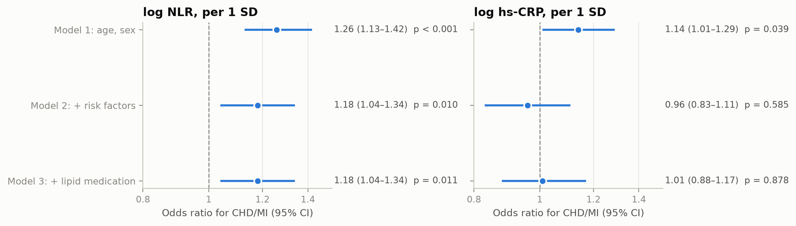
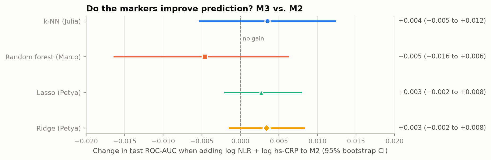
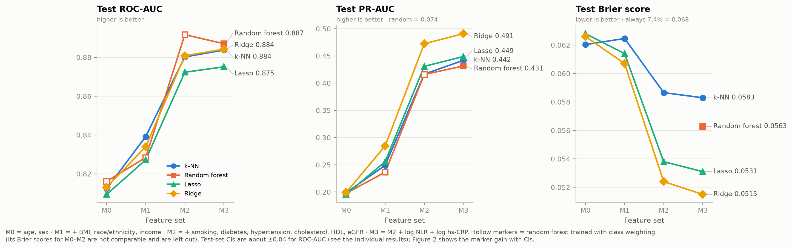

# All models side by side

[`compare_models.py`](compare_models.py) collects everyone's results and plots them together. It only
**reads** results; nothing is refitted:

| Model | Owner | Source |
|---|---|---|
| Logistic regression | Jannis | outputs saved in `notebooks/jannis/04_logistic_regression.ipynb` |
| Lasso, Ridge | Petya | outputs saved in `notebooks/Peti/01_lasso_ridge.ipynb` |
| Random forest | Marco | `notebooks/marco/results/*.csv` |
| k-NN | Julia | `notebooks/julia/results_knn/*.csv` |

Re-run it from the repo root whenever someone updates their results: `python comparison/compare_models.py`.
If a notebook's output format changes, the script stops with an error instead of plotting old numbers.
The collected numbers are saved in [`results_summary.csv`](results_summary.csv),
[`delta_auc.csv`](delta_auc.csv) and [`odds_ratios.csv`](odds_ratios.csv). All figures are in
[`figures/`](figures/) as PNG and as PDF for Overleaf.

State: results pushed up to 4 November 2026.

## 1. Are the markers associated with CHD/MI? (H1a, H1b)

Adjusted odds ratios per 1 SD of the log marker (Jannis). **NLR stays associated** after adjusting for
risk factors and lipid-lowering medication: OR 1.18 (1.04–1.34). **hs-CRP does not**: OR 1.01 (0.88–1.17).

## 2. Do the markers improve prediction? (H1c)

| Model | Owner | ΔAUC M3 − M2 (95% bootstrap CI) |
|---|---|---|
| k-NN | Julia | +0.004 (−0.005 to +0.012) |
| Random forest | Marco | −0.005 (−0.016 to +0.006) |
| Lasso | Petya | +0.003 (−0.002 to +0.008) |
| Ridge | Petya | +0.003 (−0.002 to +0.008) |

All four intervals include 0: **no model shows a clear gain from adding NLR and hs-CRP**.

## 3. Performance across feature sets

Test-set results for M3 (all feature sets: [`results_summary.csv`](results_summary.csv)):

| Model | CV ROC-AUC | Test ROC-AUC | Test PR-AUC | Test Brier |
|---|---:|---:|---:|---:|
| k-NN | 0.865 | 0.884 | 0.442 | 0.0583 |
| Random forest | 0.861 | 0.887 | 0.431 | 0.0563 |
| Lasso | 0.859 | 0.875 | 0.449 | 0.0531 |
| Ridge | 0.858 | 0.884 | 0.491 | 0.0515 |

Every model makes its big jump at **M2**, when the clinical risk factors are added. Adding the markers
(M2 → M3) barely changes anything. Ridge is as good as the flexible models and has the best PR-AUC and
Brier score.

## Read with care

- **Same test set for everyone.** All models were evaluated on the same 909 people (67 cases), and the test
  set was looked at several times while the models were being developed. The differences between models
  (about 0.01 AUC) are much smaller than the test-set uncertainty (about ±0.04), and they were not tested formally.
- **Random forest class weights.** Marco's M0–M2 models were tuned to `class_weight="balanced_subsample"`
  and M3 to no weighting (hollow markers in Figure 3). Class weighting distorts the probabilities, so those
  Brier scores are left out of the Brier panel, and the random forest ΔAUC compares two differently tuned models.
- **Missing intervals.** Petya's notebook has no confidence intervals for the single test AUCs, so
  Figure 3 shows point estimates only for all models. The marker gains in Figure 2 do have intervals for all four.
- **Rounding.** Lasso/Ridge values come from the notebook's printed output (4 decimals), and the odds ratios
  from Jannis' table (2 decimals).
- **Design.** The data are cross-sectional and the disease is prevalent, so these results describe people who
  already have a CHD/MI history. They say nothing about predicting future heart disease.
