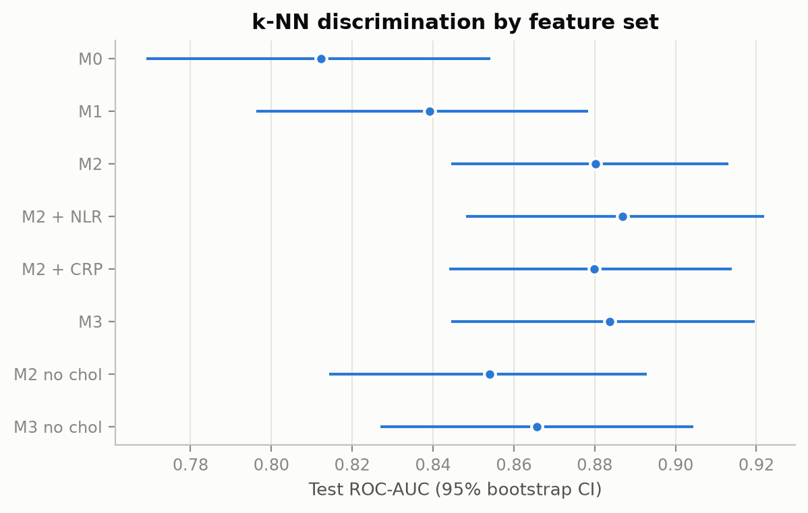
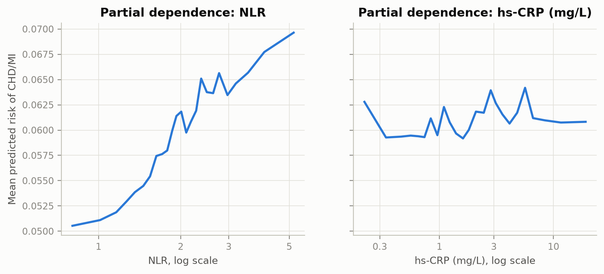
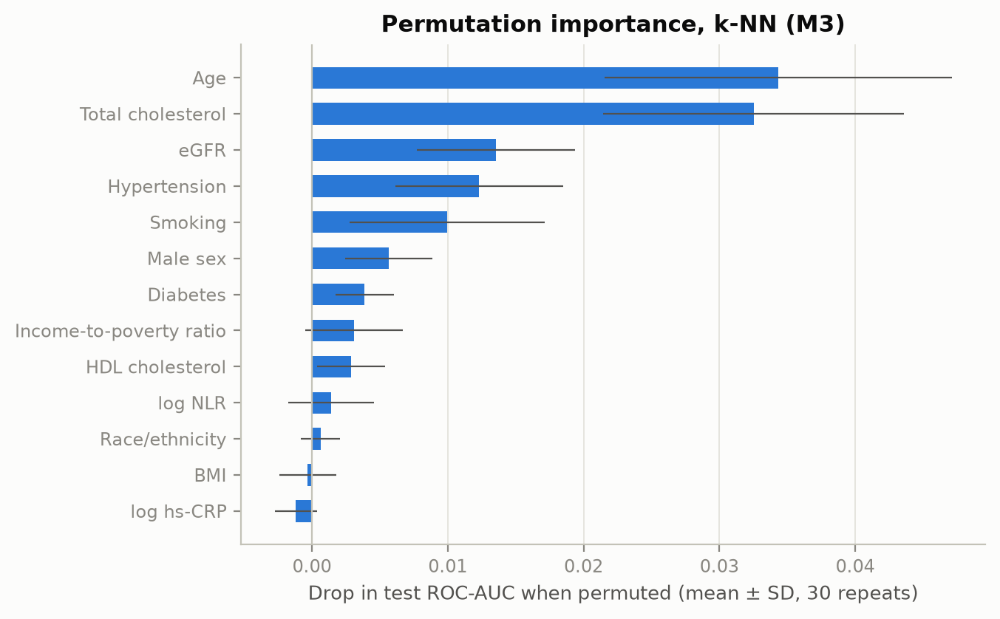
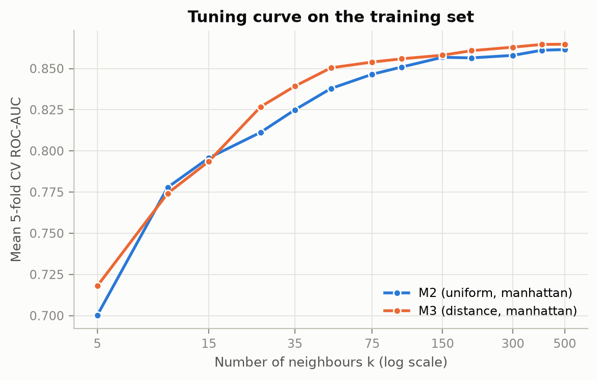
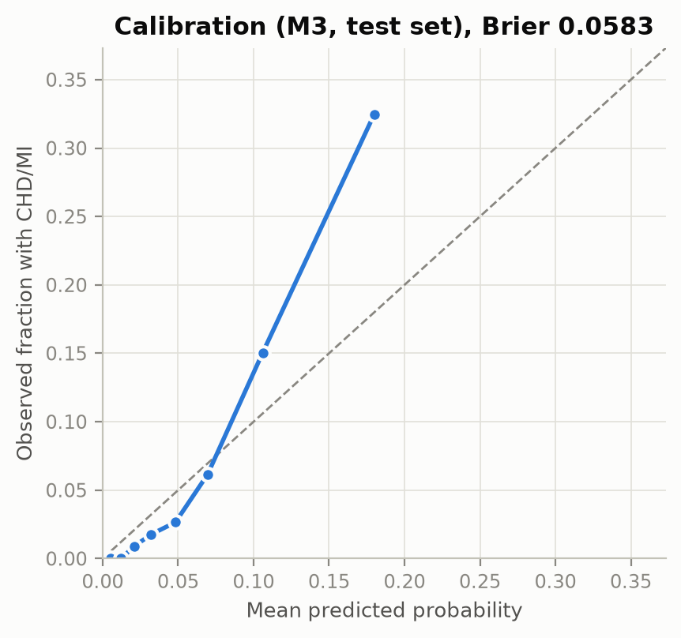
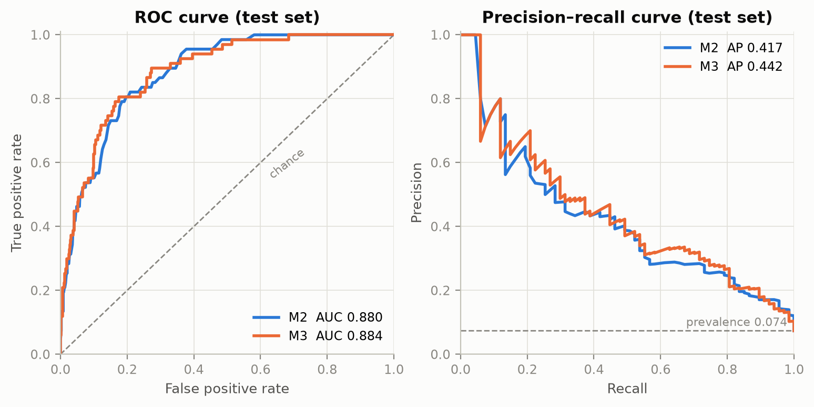

# k-nearest neighbours (k-NN): model and findings (Julia)

**Question (H1c):** do NLR and hs-CRP improve the discrimination of CHD/MI beyond established risk factors?

**Short answer:** k-NN gives no reliable evidence that they do. It separates cases from non-cases well
(test ROC-AUC 0.884 with M3), but nearly all of that comes from the risk factors. Adding both markers changes
AUC by only +0.004 (95% CI −0.005 to 0.013).

Code: [`knn_model.py`](knn_model.py). All numbers: [`results_knn/`](results_knn/).
Run from the repo root with `python notebooks/julia/knn_model.py` (about 5 minutes; no new dependencies).

## How k-NN works

To predict for a new person, k-NN finds the *k* most similar people in the training data and uses the share of
them who have CHD/MI as the predicted probability. There is no training phase and there are no coefficients: the
training data is the model. So it makes no assumption about the shape of the relationship (no linearity, no
built-in interactions), which makes it a useful contrast to the logistic models.

Three things decide how it behaves:

| Choice | What it controls | What we did |
|---|---|---|
| **k** | Small k follows local noise (high variance); large k averages over many people and smooths (high bias) | Tuned, k = 5 to 500 |
| **Distance** | What "similar" means | Tuned: Euclidean vs. Manhattan |
| **Weights** | Whether closer neighbours count more | Tuned: uniform vs. distance-weighted |

**Why preprocessing matters so much here.** Distances use the raw numbers, so without scaling, cholesterol
(range in the hundreds) would swamp a 0/1 variable like diabetes. Continuous variables are therefore z-scored.
Binary and one-hot variables stay at 0/1, so that rare categories don't get inflated distances. The scaler is
fitted inside the scikit-learn `Pipeline`, on training folds only, so no test information leaks in.

**Known weaknesses.** Every variable counts equally in the distance, including uninformative ones, and k-NN has no
built-in feature selection. Distances also become less informative as dimensions are added (curse of
dimensionality). With 7.4% cases, most neighbours are non-cases, so predictions are low and the top of the risk
range gets compressed (see finding 5).

## Setup

- **Data:** shared analytic sample from `prepare_data.py`: train n = 3,635 (270 cases), test n = 909 (67 cases).
  Unweighted, complete cases only.
- **Feature sets:** M0 = age, sex · M1 = + BMI, race/ethnicity, income · M2 = + smoking, diabetes, hypertension, total
  cholesterol, HDL, eGFR · M3 = M2 + log NLR + log hs-CRP. Also M2 + each marker alone, and M2/M3 without
  total and HDL cholesterol. No medication variables.
- **Tuning:** exhaustive grid (13 values of k × 2 distances × 2 weightings), stratified 5-fold CV on the training set,
  scoring ROC-AUC. Selected settings: [`cv_results.csv`](results_knn/cv_results.csv).
- **Evaluation:** test set, with 95% CIs from 1,000 bootstrap resamples (paired for ΔAUC). Because 67 test cases
  is few, nested CV on the training set (3 × 5 outer folds, re-tuned in each) checks whether the gain is stable.

## Findings

### 1. Performance

| Features | Selected k, weights | CV AUC | Test ROC-AUC (95% CI) | PR-AUC | Brier |
|---|---|---:|---|---:|---:|
| M0 | 200, uniform | 0.797 | 0.812 (0.769–0.854) | 0.199 | 0.062 |
| M1 | 500, uniform | 0.800 | 0.839 (0.796–0.878) | 0.249 | 0.062 |
| M2 | 500, uniform | 0.862 | 0.880 (0.845–0.913) | 0.417 | 0.059 |
| M2 + NLR | 300, distance | 0.862 | 0.887 (0.848–0.922) | 0.447 | 0.057 |
| M2 + CRP | 500, uniform | 0.862 | 0.880 (0.844–0.914) | 0.411 | 0.059 |
| **M3** | 500, distance | 0.865 | **0.884 (0.845–0.920)** | 0.442 | 0.058 |
| M2 no cholesterol | 500, distance | 0.833 | 0.854 (0.814–0.893) | 0.369 | 0.060 |
| M3 no cholesterol | 500, distance | 0.836 | 0.866 (0.827–0.904) | 0.412 | 0.060 |

All selected models use Manhattan distance. Reference values: PR-AUC baseline (prevalence) 0.074; Brier score of always
predicting the training prevalence 0.068. Test AUCs are about 0.02 above CV, so this split looks slightly easy;
expect roughly 0.86–0.87 rather than 0.88.

### 2. The markers add little

| Comparison | Test ΔAUC (95% CI) | Nested CV mean ΔAUC | Folds with a gain |
|---|---|---:|---:|
| M2 + NLR vs. M2 | +0.007 (−0.001 to 0.015) | +0.001 | 9 / 15 |
| M2 + CRP vs. M2 | −0.000 (−0.006 to 0.005) | +0.000 | 9 / 15 |
| M3 vs. M2 | +0.004 (−0.005 to 0.013) | +0.003 | 9 / 15 |
| M3 vs. M2, both without cholesterol | +0.012 (0.002 to 0.022) | +0.002 | 9 / 15 |

The first three intervals include 0, and the nested CV gains are close to 0. The fourth interval excludes 0, but
it should not be read as a positive result: it is one of several unadjusted comparisons, the feature set was
added after an earlier look at this test set, and nested CV does not reproduce it (+0.002). At most, it suggests
the markers might matter slightly more once cholesterol is removed. These results also can't rule out a small true
gain, since the CIs allow up to about +0.013 for M3.

### 3. NLR shows a modest signal, CRP almost none

Holding the other variables at their observed values, mean predicted risk rises from about 5.1% at NLR 0.8 to 7.0% at
NLR 5.2, while it stays between 5.9% and 6.4% across hs-CRP 0.2 to 19 mg/L. The small jagged steps are noise from
neighbour counts. Note the zoomed y-axis, and that large k shrinks these curves. This shows what the model learned,
not a causal dose-response. The adjusted estimates in the logistic regression are the right place to test H1a/H1b.

### 4. Age and total cholesterol drive the predictions

Permuting age or total cholesterol lowers test AUC by about 0.03 each; NLR by 0.001, and hs-CRP not at all (−0.001).
Correlated variables share credit, so a low value doesn't prove a variable is unrelated to CHD/MI.

Removing total and HDL cholesterol costs 0.026 test AUC (95% CI 0.004 to 0.048), and about 0.03 in CV. That matters
because cases have *lower* cholesterol than non-cases (median 151 vs. 188 mg/dL), probably in part
because of lipid-lowering treatment: the gap appears both with treatment (147 vs. 172) and without (178 vs. 194).
So some of the M2 performance may reflect who is already treated, rather than risk before diagnosis. We can't
separate these with this cross-sectional data, so **M2 without cholesterol is a useful lower reference**, and the
team should decide whether to report it (decision log, B6).

### 5. The best k is very large, and high risks are under-predicted

CV AUC rises steeply with k (best per k for M3: 0.72 at k = 5, 0.83 at k = 25, 0.86 at k = 100, 0.865 at k = 500). k = 500 is
about 14% of the training set, so each prediction averages over a large group. That suggests the signal here is broad
and smooth, rather than made of small local patterns, though it doesn't by itself show what shape the signal has.

k = 500 is the top of the grid, so I checked larger values on the training set only, with the decision rule fixed
beforehand: keep the grid unless a larger k improves CV AUC by more than 0.005. The largest gain was 0.0034, so the
grid stayed ([`k_boundary_check.csv`](results_knn/k_boundary_check.csv)).

Differences between settings are small: for M3, Manhattan reaches 0.865 and Euclidean 0.861; weighting barely matters.
Both are well within the fold-to-fold SD of about 0.017, so these choices shouldn't be over-interpreted.

| | |
|---|---|
|  |  |

**Calibration:** the Brier score beats the prevalence baseline only modestly (0.058 vs. 0.068). In the highest-risk octile
the model predicts about 18% where about 32% actually have CHD/MI, and low risks are slightly over-predicted. Large-k
averaging pulls predictions toward the overall rate, so use the ranking rather than the absolute probabilities, or recalibrate.

### 6. Performance at a fixed threshold (M3, test set)

The threshold (0.071) maximises Youden's J on out-of-fold training predictions, so it was set without the test set.

| Sensitivity | Specificity | PPV | NPV |
|---:|---:|---:|---:|
| 0.87 (0.78–0.94) | 0.74 (0.71–0.77) | 0.21 (0.16–0.26) | 0.99 (0.98–0.99) |

About one in five people flagged has CHD/MI. This is not a screening result: the outcome is self-reported, already
diagnosed disease, so the model recognises existing history and not future risk.

### 7. Comparison with the earlier random forest and gradient boosting runs

| Model (M3) | CV AUC | Test ROC-AUC | PR-AUC | Brier |
|---|---:|---:|---:|---:|
| k-NN | 0.865 | 0.884 | 0.442 | 0.058 |
| Random forest | 0.860 | 0.888 | 0.436 | 0.056 |
| Gradient boosting | 0.857 | 0.893 | 0.441 | 0.127 |

The three are effectively tied; the differences are small relative to the CIs (about ±0.04), and they weren't formally
tested. Gradient boosting's Brier score comes from class weighting, not poor ranking. The more flexible models don't
beat a simple neighbour average, which fits the idea of a smooth signal. The real test of that is the comparison with
Jannis's logistic regression and Petya's Lasso/Ridge, ideally on these same feature sets and test participants.
Random forest is now Marco's part; those numbers are just a reference ([`RESULTS.md`](RESULTS.md)).

## Limitations

- **Test set use.** This split had already been used for the earlier random forest and boosting analysis, and that
  analysis is what prompted the no-cholesterol sets, so those two are post hoc. The k-NN settings and threshold were
  chosen on training data only. The script was run twice to add the boundary check and fix a tick label; all
  k-NN results compared between the two runs were identical.
- **Many comparisons, few cases.** Eight feature sets and five ΔAUC comparisons on 67 test cases, with no multiplicity
  adjustment. The intervals are descriptive and don't account for hyperparameter selection.
- **Inherited from the design:** cross-sectional and prevalent disease (markers measured after diagnosis, reverse
  causation possible), self-reported outcome, complete cases only (selection bias), and unweighted (results
  describe this sample, not the US population). Age and income are top-coded in NHANES.
- **Not explored:** learned feature weighting or feature selection for the distance, and imputation to include the eligible
  sample. Since every variable counts equally in the distance, weighting could change the results.

## Figures

PNG and PDF versions for Overleaf are in [`results_knn/figures/`](results_knn/figures/).
ROC and precision-recall curves: `roc_pr_m2_m3`.

