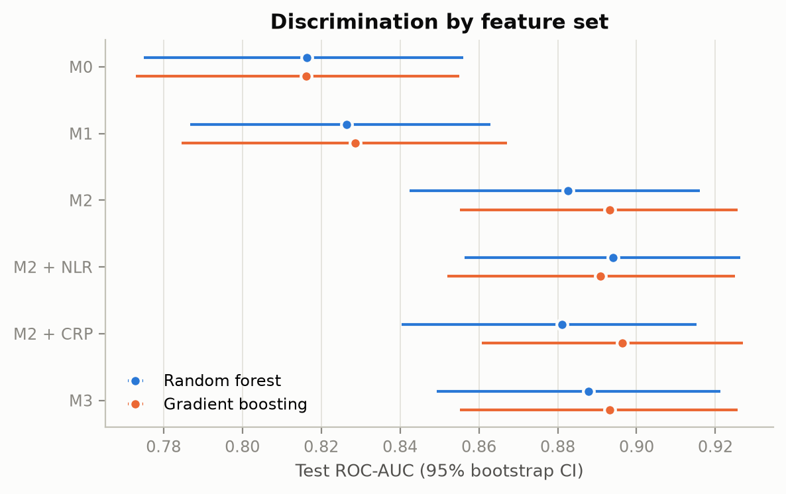
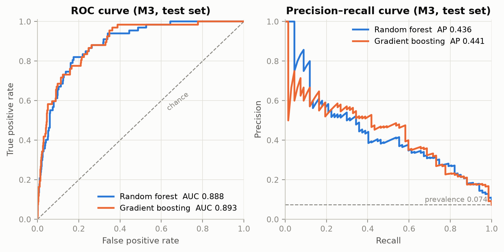
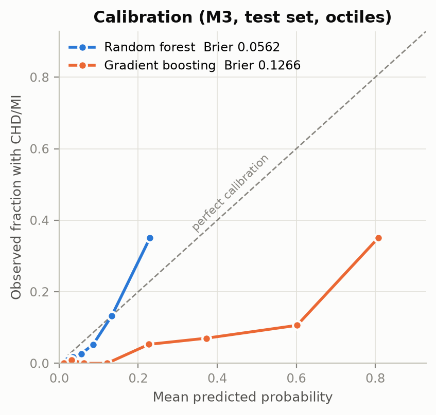
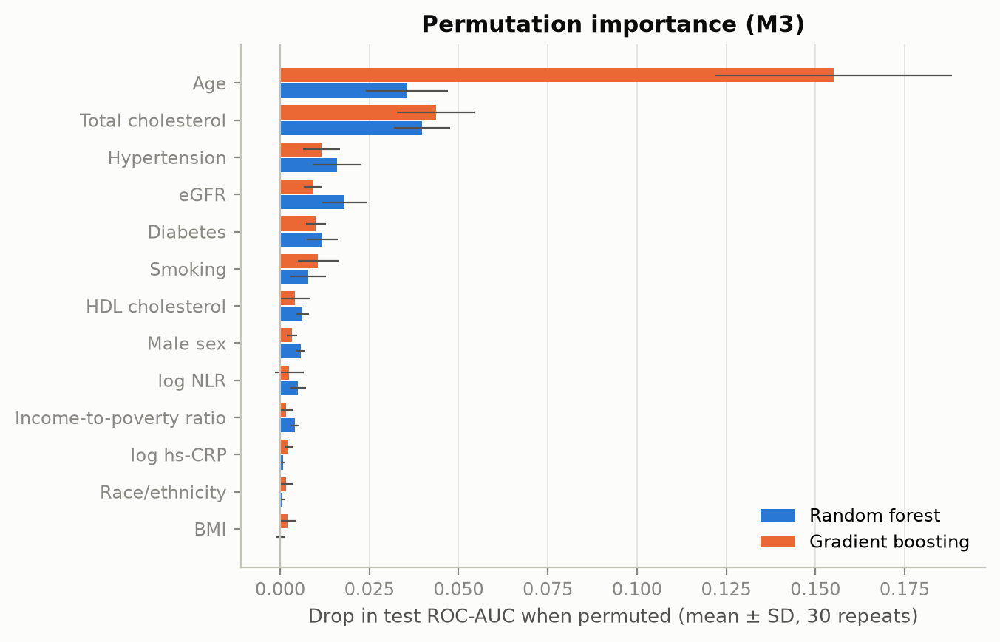
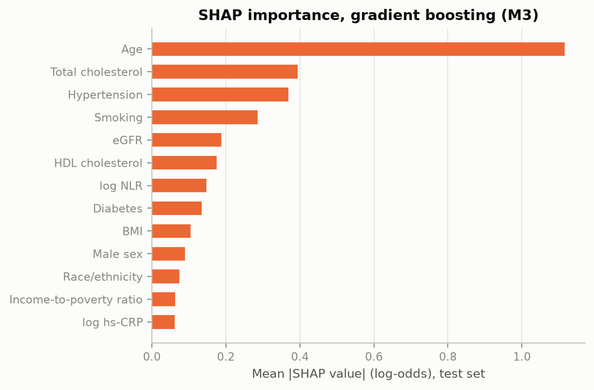
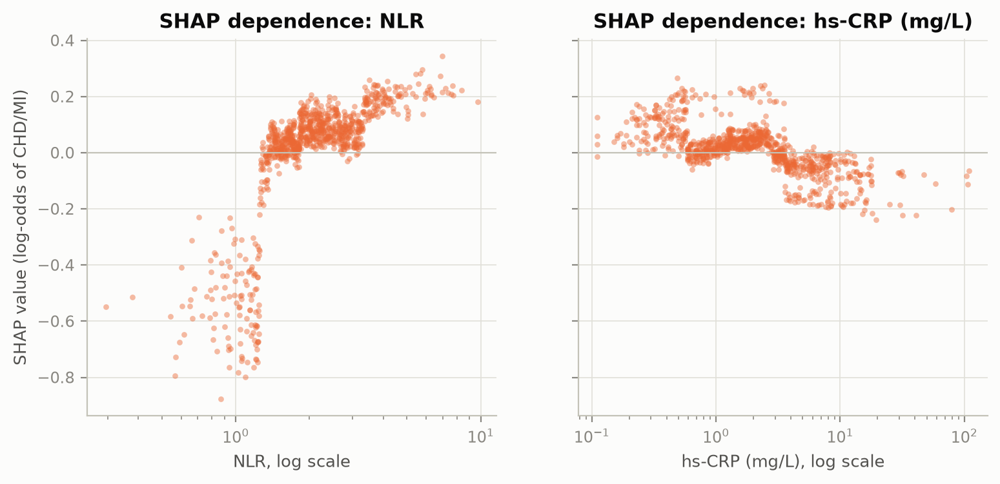

# Package D: flexible prediction models (Julia)

Random forest and gradient boosting (`HistGradientBoostingClassifier`) for the secondary question
**H1c: do NLR and hs-CRP add discriminative information beyond established risk factors?**

Code: [`flexible_models.py`](flexible_models.py) (runs top to bottom in ~4 min; `# %%` cells also open
as a notebook in VS Code / Jupyter). All numbers below are in [`results/`](results/).

## Setup

- Analytic sample from `prepare_data.py`: train n = 3,635 (270 cases), test n = 909 (67 cases), prevalence 7.4%.
- Feature sets: M0 = age, sex · M1 = + BMI, race/ethnicity, income · M2 = + smoking, diabetes,
  hypertension, total cholesterol, HDL, eGFR · M3 = M2 + log NLR + log hs-CRP (also M2 + NLR and M2 + CRP alone).
  No medication variables.
- Tuning: randomized search (25 candidates) with stratified 5-fold CV on the training set, scoring ROC-AUC;
  `class_weight` (none vs. balanced) was one of the tuned hyperparameters.
- Test set used once; 95% CIs from 1,000 bootstrap resamples (paired for ΔAUC).

## Results

**Test-set performance** ([`test_performance.csv`](results/test_performance.csv))

| Model | Features | ROC-AUC (95% CI) | PR-AUC | Brier |
|---|---|---|---:|---:|
| Random forest | M0 | 0.816 (0.775–0.856) | 0.197 | 0.182 |
| Random forest | M2 | 0.883 (0.842–0.916) | 0.423 | 0.056 |
| Random forest | M3 | 0.888 (0.849–0.921) | 0.436 | 0.056 |
| Gradient boosting | M0 | 0.816 (0.773–0.855) | 0.193 | 0.187 |
| Gradient boosting | M2 | 0.893 (0.855–0.926) | 0.437 | 0.131 |
| Gradient boosting | M3 | 0.893 (0.855–0.926) | 0.441 | 0.127 |

PR-AUC baseline (prevalence) = 0.074. CV AUCs on the training set were ~0.03 lower (0.86 for M2/M3),
so the test split is on the "easy" side, and the CV numbers are probably the more honest estimate.

**Added value of the markers** ([`delta_auc.csv`](results/delta_auc.csv))

| Comparison | Random forest ΔAUC (95% CI) | Gradient boosting ΔAUC (95% CI) |
|---|---|---|
| M2 + NLR vs. M2 | +0.012 (−0.000 to 0.024) | −0.002 (−0.011 to 0.006) |
| M2 + CRP vs. M2 | −0.002 (−0.004 to 0.001) | +0.003 (−0.002 to 0.009) |
| M3 vs. M2 | +0.005 (−0.002 to 0.014) | +0.000 (−0.010 to 0.008) |

## Takeaways

1. **No clear added discrimination from NLR or hs-CRP (H1c not supported by the flexible models).**
   Almost all of the gain comes from the risk factors in M2 (0.82 → 0.88–0.89). The only borderline
   signal is NLR in the random forest (+0.012, CI just touching 0), which does not replicate in boosting.
2. **NLR carries some signal, hs-CRP barely any.** NLR ranks 7th of 13 by SHAP; hs-CRP ranks last by SHAP and near the bottom in
   permutation importance. The SHAP dependence plot shows higher predicted risk with rising NLR
   (mostly a step around NLR ≈ 1.3), whereas high hs-CRP (> 3 mg/L) slightly *lowers* predicted risk:
   consistent with statins lowering CRP in diagnosed patients. This is good material for the Discussion.
3. ⚠️ **Total cholesterol is the 2nd most important feature, and it works "backwards".** Cases have *lower*
   cholesterol than controls (median 151 vs. 188 mg/dL), driven by lipid-lowering treatment (cases on
   meds: 147; controls without meds: 194). So cholesterol partly acts as a proxy for "already treated",
   which is the leakage concern from B3 point 10, and probably part of the M1 → M2 jump.
   **Suggestion:** add a sensitivity feature set without total/HDL cholesterol (decide as a team and log in B6).
4. **Calibration:** the tuning picked `class_weight="balanced"` for boosting. That keeps ranking (AUC) but
   inflates predicted probabilities (Brier 0.127 vs. 0.056 for the unweighted random forest, see
   calibration plot). For any probability-based reporting, use unweighted models or recalibrate.
5. **Missing data (native NaN handling):** boosting trained on the eligible sample (n = 4,430 train, no
   imputation) reaches AUC 0.873 overall but only **0.78 on the 199 test participants with missing
   covariates** vs. 0.89 on the complete cases ([`eligible_native_nan_gb.csv`](results/eligible_native_nan_gb.csv)).
   People with incomplete data are harder to classify, which is a hint that they differ systematically.
   This is relevant for the selection-bias paragraph.

## Figures (PNG + PDF for Overleaf in `results/figures/`)

| | |
|---|---|
|  |  |
|  |  |

## Open points for the team

- Package C (logistic models) should use the same feature sets and the same bootstrap-ΔAUC approach so
  Table 3 is consistent. Happy to move the evaluation helpers into a shared `evaluation.py`.
- Decide whether cholesterol stays in M2 (see takeaway 3).
- Since the test set has now been looked at, any further model changes should be justified on CV results only.
