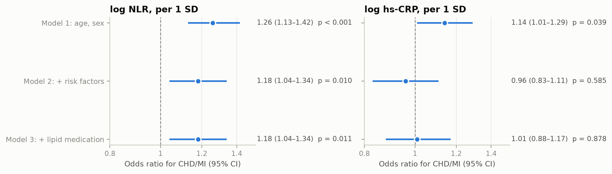
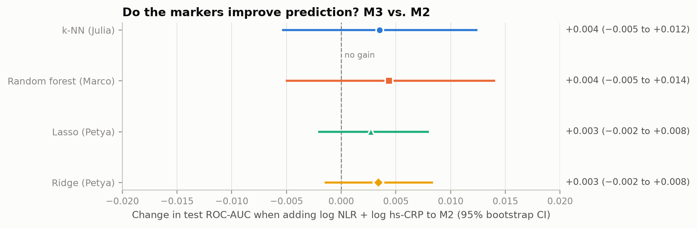
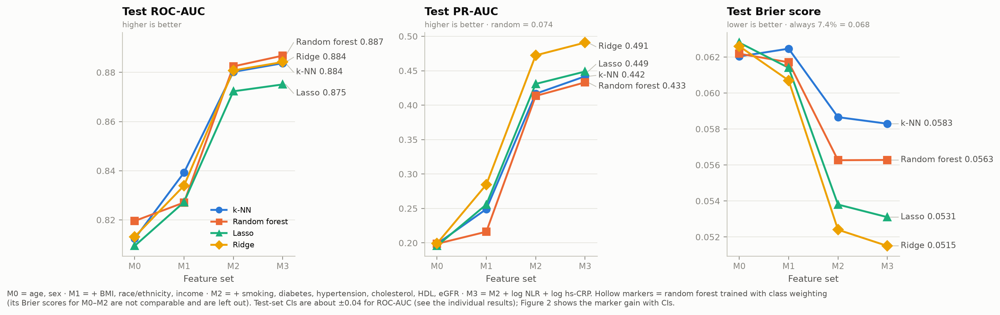
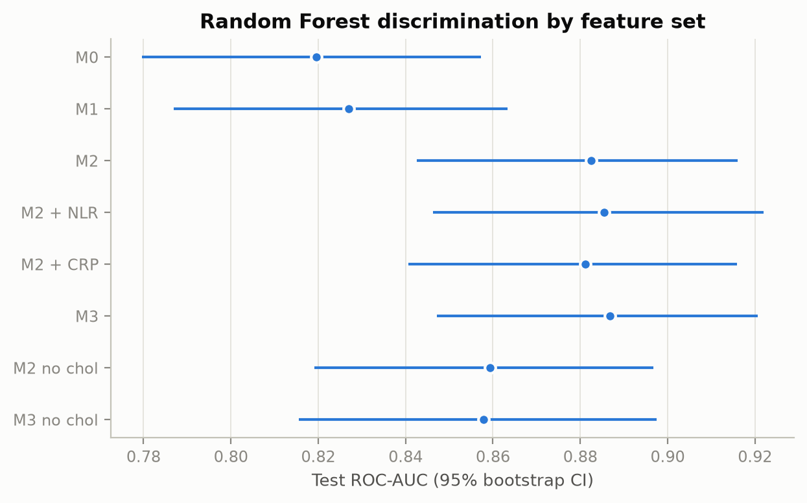
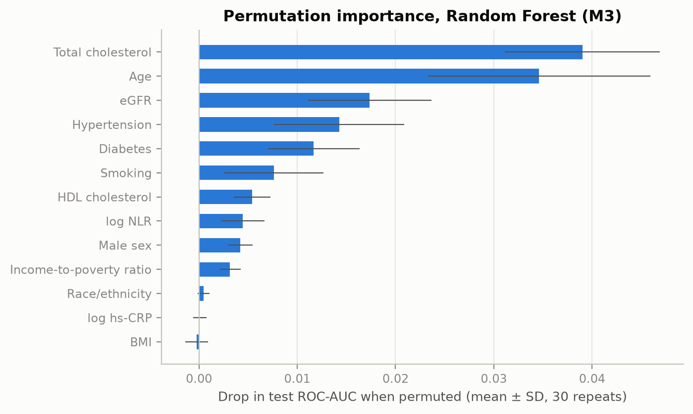
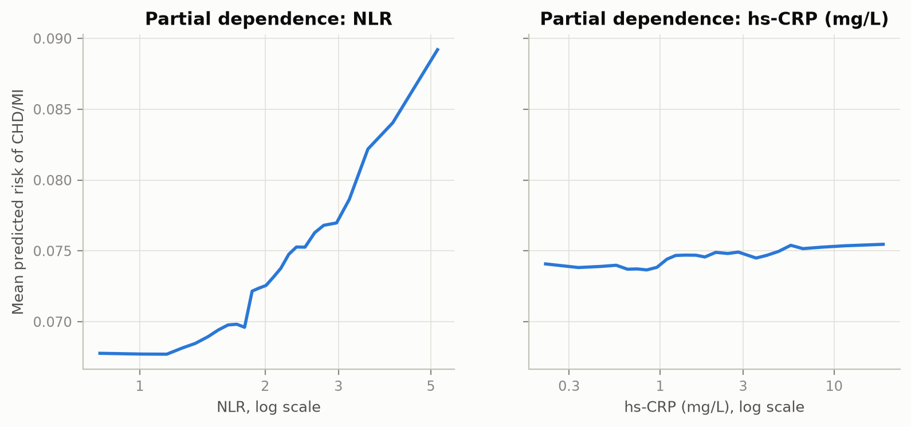

# Midterm Presentation Visual Summary (Solo · 10 Min + 5 Min Q&A)
**Course:** ETH Zürich *Foundations of Data Science* (`376-1983-00L`)  
**Topic:** Incremental Predictive Value of Systemic Inflammatory Markers (NLR & hs-CRP) for CHD/MI in US Adults (NHANES 2021–2023)

---

## 7-Slide Checklist Aligned with FoDS Midterm Email

| Slide | Email Requirement | Time Budget | Key Content / Visual |
| :---: | :--- | :---: | :--- |
| **1** | **1. Research Topic** | `0:00–1:00` | Clinical background (`Ridker 2002`, `Adamstein 2021`) & dual RQ (association vs. ML prediction gain) |
| **2** | **2. Features & Labels** | `1:00–2:15` | Binary target `chd_mi` (`MCQ160C`/`MCQ160E`, `7.42%`) + `13` predictors (`M0–M3`; meds excluded from ML) |
| **3** | **3. Preprocessing Steps** | `2:15–3:30` | Codebook cleaning (`clean_raw()`), filtering funnel (`11,933 → 4,544`), log-transforms, selection-bias check |
| **4** | **4. Analysis Plan** | `3:30–4:45` | Stratified `80/20` split + 5-fold CV, 4 ML paradigms (`LR`, `Lasso/Ridge`, `k-NN`, `RF`) + Remaining 20% |
| **5** | **5a. Preliminary Results (Overview)** | `4:45–6:15` | `1_association_odds_ratios.png` + `2_marker_gain_delta_auc.png` (`OR = 1.18` vs. `ΔAUC ≈ +0.003–0.004`) |
| **6** | **5b. Results (Calibration & Importance)** | `6:15–7:25` | `3_performance_by_feature_set.png`*(crop obsolete footer)* + `permutation_importance_m3.png` (Statin paradox) |
| **7** | **6. Takeaway & Questions for TAs** | `7:25–8:10` | Core synthesis + 3 strategic methodology questions (kept visible during `5 min` Q&A) |

---

## 1 & 2. Research Topic, Label & Nested Feature Overview

- **Target Label (`chd_mi`):** Binary indicator (`1` if self-reported doctor diagnosis of coronary heart disease `MCQ160C` OR heart attack/MI `MCQ160E`; `0` if both negative; angina `MCQ160D` excluded per `CONFIG["include_angina"] = False`). Analytic prevalence: **`7.42%`** (`337 / 4,544`).
- **Inflammatory Exposures (from CBC & hs-CRP assay):**
  - `nlr` = Neutrophil % / Lymphocyte % (`LBXNEPCT / LBXLYPCT`) → log-transformed as `log_nlr`
  - `crp` = High-sensitivity C-reactive protein (`LBXHSCRP`, mg/L) → log-transformed as `log_crp`
- **Nested Feature Sets (`M0` → `M3`) & Sensitivity Models:**
  - **`M0` (Demographics):** `age` *(top-coded at 80)*, `male`
  - **`M1` (+ SES / Anthropometry):** `+ bmi`, `race_eth` *(6 categories)*, `income_pir` *(top-coded at 5)*
  - **`M2` (+ Standard Clinical Risk Factors):** `+ smoking` *(never/former/current)*, `diabetes`, `hypertension` *(`BPQ020` or mean of 3 readings `>= 140/90`)*, `total_chol`, `hdl_chol`, `egfr` *(race-free CKD-EPI 2021)*
  - **`M3` (+ Primary Test Markers):** `M2 + log_nlr + log_crp`
  - **Treatment Variables (`lipid_med`, `bp_med`):** **Never used as ML features** (prevents target/treatment leakage; `lipid_med` used only in Jannis's `Model 3` adjustment).
  - **Sensitivity Sets:** `M2 + NLR`, `M2 + CRP`, `M2 no chol`, `M3 no chol`.

---

## 3. Preprocessing Pipeline (`prepare_data.py`)

```text
Raw NHANES 2021–2023 (11,933 × 763)
   └─ clean_raw() via nhanes_metadata.csv:
        • 124,640 non-numeric junk cells ──▶ NaN
        • SAS near-zero (< 1e-70)        ──▶ 0.0
        •  10,439 documented non-response──▶ NaN
        •      93 codebook out-of-range  ──▶ NaN   (135,172 total cleaned cells)
   └─ Inclusion / Exclusion Funnel:
        n = 11,933 (559 cases, 4.68%) All participants
         └─ Exclude age < 20 (-4,124)     ──▶ n = 7,809 (559 cases, 7.16%)
         └─ Exclude missing CHD/MI (-36)  ──▶ n = 7,773 (559 cases, 7.19%)
         └─ Exclude missing NLR/CRP(-2235)──▶ n = 5,538 (412 cases, 7.44%)
         └─ Complete covariates (-994)    ──▶ n = 4,544 (337 cases, 7.42%)
              ├─ Stratified 80% Train (seed=42): n = 3,635 (270 cases, 7.4%) [5-Fold Stratified CV]
              └─ Stratified 20% Test  (seed=42): n =   909 ( 67 cases, 7.4%) [Untouched lockbox]
```

*(Note on Missingness: `income_pir` misses `706` rows = `12.7%` in the eligible sample; Jannis's `03_selection_bias.ipynb` showed excluded groups have lower income [`p < 0.001`] and higher Non-Hispanic Black share [`15.5%` vs `10.8%`], while CHD/MI prevalence stays similar [`7.4%` vs `6.6%`/`7.5%`].)*

---

## 4 & 5. Preliminary Results — Statistical Inference vs. ML Prediction

### Part A — Statistical Association (Jannis: Logistic Regression)



- **`log NLR` stays independently associated:** Even after demographics, clinical risk factors, and `lipid_med` (`Model 3`), 1 SD higher `log NLR` associates with **+18% higher odds of CHD/MI** (`OR = 1.18, 95% CI 1.04–1.34, p = 0.011`, passes Bonferroni `α = 0.025`).
- **`log hs-CRP` washes out:** Significant with age & sex (`OR = 1.14, p = 0.039`), then drops to null after adjustment (`Model 2 OR = 0.96, p = 0.585`; `Model 3 OR = 1.01, p = 0.878`).

### Part B — Harmonized 4-Model Comparison (`Test n = 909`, Uniform `class_weight=None`)




*(Presentation Slide Tip: Crop/cover the bottom footnote in `3_performance_by_feature_set.png` — its note about hollow weighted RF markers is outdated now that all 4 models run unweighted.)*

| Model (Owner) | M2 ROC-AUC | M3 ROC-AUC | ΔAUC (`M3 vs M2`, 95% CI) | M3 PR-AUC | M3 Brier |
| :--- | :---: | :---: | :---: | :---: | :---: |
| **k-NN** (Julia) | `0.880` | `0.884` | `+0.0035 (-0.0054 to +0.0125)` | `0.442` | `0.058` |
| **Random Forest** (Marco) | `0.882` | **`0.887`** | `+0.0044 (-0.0051 to +0.0141)` | `0.433` | `0.056` |
| **Lasso** (Petya) | `0.872` | `0.875` | `+0.0027 (-0.0021 to +0.0080)` | `0.449` | `0.053` |
| **Ridge** (Petya) | `0.881` | `0.884` | `+0.0034 (-0.0015 to +0.0084)` | **`0.491`** | **`0.052`** |

### Part C — Marco's Random Forest Deep Dive & Explainability

| RF Key Metric (`M3`, Test `n = 909`) | Exact Value | Plain-Language Meaning |
| :--- | :---: | :--- |
| **Test ROC-AUC (`M3` vs `M2`)** | **`0.8868`** vs `0.8824` | High ranking discrimination driven by `M2`; markers add `ΔAUC = +0.0044 (p = 0.149)` |
| **Test PR-AUC (`M3` vs Baseline)** | **`0.4330`** vs `0.074` | ~5.8× lift over baseline prevalence |
| **Test Brier Score (`M3` vs Null)** | **`0.0563`** vs `0.0683` | Calibrated risk estimates (`balanced_subsample` inflates Brier to `0.081–0.107`) |
| **Sensitivity / Specificity (`J = 0.0883`)** | **`86.6%` / `74.2%`** | OOF-selected threshold gives `NPV = 98.6%`, `PPV = 21.1%` |
| **Statin Sensitivity (`M2 vs M2 no chol`)** | **`ΔAUC = +0.0231`** | Dropping cholesterol reduces RF AUC (`p = 0.024`): `79.8%` cases vs `25.4%` controls on statins (`total_chol 159.9` vs `190.9 mg/dL`) |







---

## 6. Strategic Questions for the FoDS Team (for the 5-Min Feedback Slot)

1. **Complete-Case vs. MICE Imputation (`income_pir` ~13% missing):** Since excluded people had slightly lower income (while heart-disease rates stayed similar), is keeping complete-case as the primary analysis plus **MICE imputation inside CV** as a sensitivity check the right approach for the final submission?
2. **NHANES Survey Weights (`weight_mec`, `strata`, `psu`):** Should we apply complex survey weights only in our **inferential Logistic Regression** (for US population-representative odds ratios) while keeping ML benchmarks unweighted, or should we sample-weight the ML models too?
3. **Hold-Out Reuse vs. Nested CV (`67` test cases):** Because we test several model variants (`M0–M3`, `no chol`) on `n = 909` test patients (`±0.04` CIs), do you recommend transitioning our final comparison to **Nested Cross-Validation** for more stable `ΔAUC` intervals?
