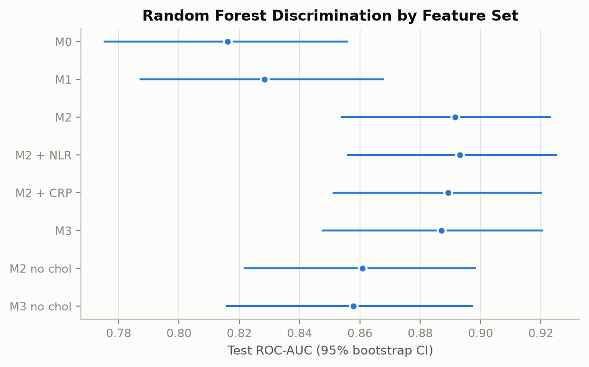
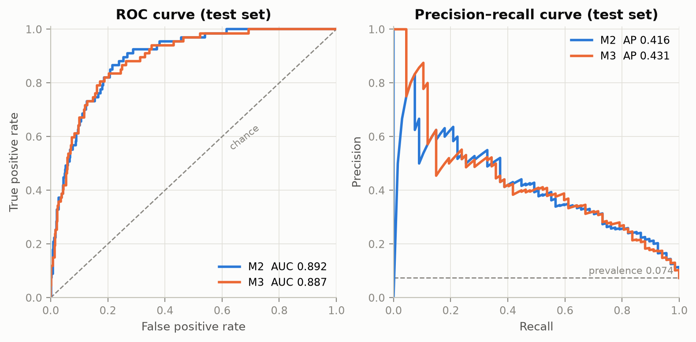
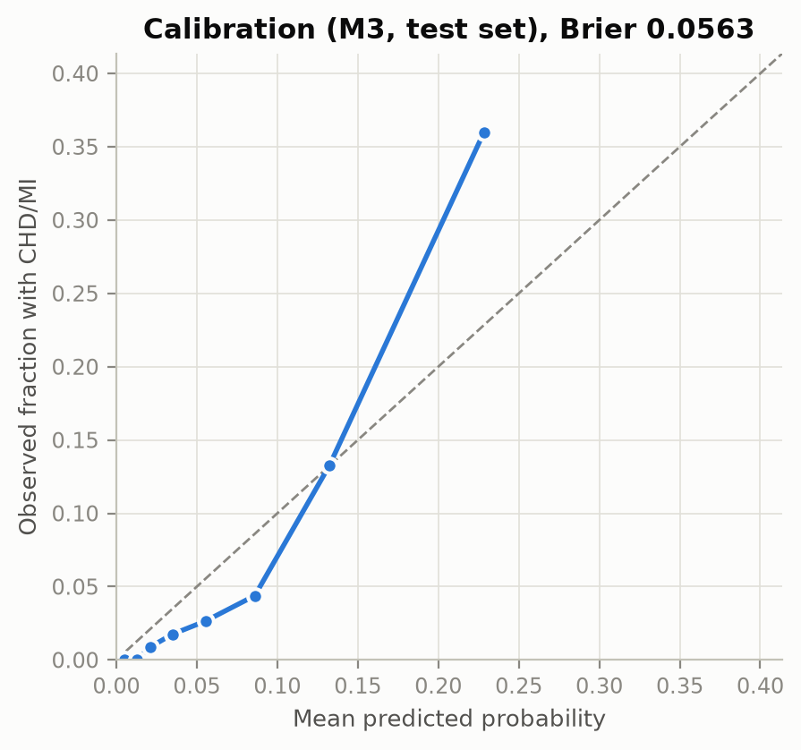
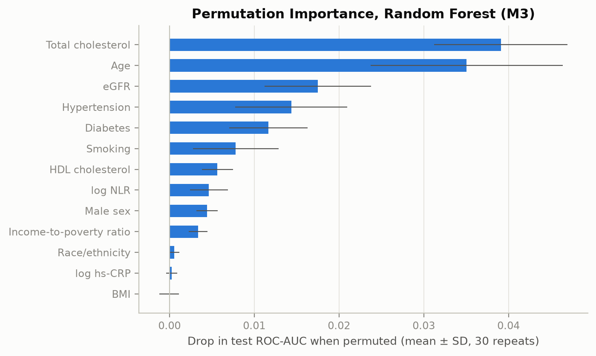
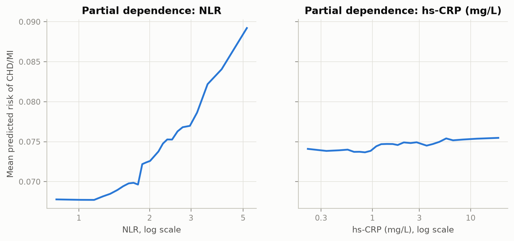

# Random Forest: Model and Findings (Marco)

**Question (H1c):** Do NLR and hs-CRP improve the discrimination of CHD/MI beyond established cardiovascular risk factors?

**Short answer:** No. Random Forest achieves high discrimination overall (test ROC-AUC 0.892 with M2, 0.887 with M3), but the inflammatory markers add no meaningful predictive power. Adding both markers changes the test ROC-AUC by −0.005 (95% CI −0.016 to +0.006, $p = 0.785$). NLR alone shows a negligible gain of +0.0015 (95% CI −0.008 to +0.012), while hs-CRP adds nothing (−0.002).

Code: [`random_forest_model.py`](random_forest_model.py) · Notebook: [`02_random_forest.ipynb`](02_random_forest.ipynb) · All outputs: [`results/`](results/).

---

## How Random Forest Works (Intuition & Theory)

A **Random Forest** is an ensemble learner based on **Bagging (Bootstrap Aggregation)** of de-correlated **Decision Trees** (FoDS Lecture Week 7):

1. **Individual Trees (High Variance, Low Bias):** A single decision tree recursively splits feature space based on Gini impurity. Unconstrained, a single tree easily overfits training noise.
2. **Bootstrap Aggregation (Bagging):** Random Forest trains 300 independent trees, each on a random bootstrap sample (drawn with replacement) from the training data. Averaging their predictions drastically reduces model variance without increasing bias.
3. **Random Subspace (Feature De-correlation):** At every split within every tree, only a random subset of features (`max_features`) is considered. This prevents dominant predictors (like Age or Cholesterol) from dictating every single tree, ensuring diverse perspectives across the forest.
4. **Ensemble Voting / Probability:** The final predicted risk is the unweighted average of class probabilities across all 300 trees.

| Hyperparameter | What it controls | Tuned Values / Selected (M3) |
|---|---|---|
| `n_estimators` | Number of trees in the forest | Fixed at 300 (stable variance reduction) |
| `max_depth` | Maximum split depth of trees | Tuned: None, 4, 6, 8, 12 → **Selected: 12** |
| `min_samples_leaf` | Minimum samples in leaf node | Tuned: 1, 5, 10, 20, 50 → **Selected: 50** |
| `max_features` | Random feature subset size per split | Tuned: sqrt, 0.3, 0.5 → **Selected: sqrt** |
| `class_weight` | Penalisation of minority class (7.4% CHD cases) | Tuned: None vs. balanced_subsample → **Selected: None (for M3)** |

---

## Experimental Setup

- **Data Cohort:** Shared analytical sample from `prepare_data.py`:
  - Train: $n = 3{,}635$ (270 cases, 7.4% prevalence)
  - Test: $n = 909$ (67 cases, 7.4% prevalence)
- **Nested Feature Sets:**
  - $M_0$: Demographics floor (`age`, `male`)
  - $M_1$: Sociodemographics (`M0` + `bmi`, `race_eth`, `income_pir`)
  - $M_2$: Established clinical risk factors (`M1` + `smoking`, `diabetes`, `hypertension`, `total_chol`, `hdl_chol`, `egfr`)
  - $M_2 + \text{NLR}$: `M2` + `log_nlr`
  - $M_2 + \text{CRP}$: `M2` + `log_crp`
  - $M_3$: Full model (`M2` + `log_nlr` + `log_crp`)
  - Sensitivity sets without cholesterol: `M2 no chol`, `M3 no chol` (evaluating treatment-proxy bias)
- **Pipeline & Leakage Protection:**
  - OneHotEncoder for categoricals (`race_eth`, `smoking`) strictly fitted within `Pipeline`. Numeric features passthrough (trees are invariant to monotonic scaling).
  - Hyperparameter tuning via Stratified 5-Fold Cross-Validation on the training set only (`RandomizedSearchCV`).
  - Test set evaluated strictly once at the end with 1,000 bootstrap resamples for 95% confidence intervals and paired $\Delta\text{AUC}$ tests.

---

## Key Findings

### 1. Overall Performance Across Feature Sets

| Features | Selected Hyperparameters | 5-Fold CV AUC | Test ROC-AUC (95% CI) | PR-AUC | Brier Score |
|---|---|---:|---|---:|---:|
| $M_0$ | depth=4, leaf=50, feat=0.5, balanced | 0.794 ± 0.009 | 0.816 (0.775–0.856) | 0.198 | 0.183 |
| $M_1$ | depth=4, leaf=50, feat=0.5, balanced | 0.801 ± 0.010 | 0.828 (0.787–0.868) | 0.236 | 0.172 |
| $M_2$ | depth=None, leaf=20, feat=sqrt, balanced | 0.859 ± 0.014 | **0.892 (0.854–0.923)** | 0.416 | 0.107 |
| $M_2 + \text{NLR}$ | depth=None, leaf=20, feat=sqrt, balanced | 0.862 ± 0.015 | **0.893 (0.856–0.925)** | **0.445** | 0.104 |
| $M_2 + \text{CRP}$ | depth=None, leaf=20, feat=sqrt, balanced | 0.859 ± 0.015 | 0.889 (0.851–0.920) | 0.407 | 0.105 |
| **$M_3$ (Full)** | depth=12, leaf=50, feat=sqrt, None | **0.861 ± 0.014** | **0.887 (0.848–0.921)** | **0.432** | **0.056** |
| $M_2$ no chol | depth=12, leaf=50, feat=sqrt, None | 0.836 ± 0.021 | 0.861 (0.822–0.898) | 0.348 | 0.059 |
| $M_3$ no chol | depth=4, leaf=20, feat=sqrt, None | 0.838 ± 0.021 | 0.858 (0.816–0.898) | 0.367 | 0.059 |

*Reference baselines:* PR-AUC baseline (prevalence) = 0.074. Brier null baseline (always predicting prevalence) = 0.068.

---

### 2. Added Value of Inflammatory Markers ($\Delta\text{AUC}$)

Paired bootstrap tests (1,000 resamples evaluated on the exact same patient draws):

| Comparison | Test $\Delta\text{AUC}$ | 95% Bootstrap CI | $p$-value ($p_{\Delta \le 0}$) | CV OOF $\Delta\text{AUC}$ |
|---|---:|---|---:|---:|
| $M_2 + \text{NLR}$ vs. $M_2$ | **+0.0015** | (−0.0084 to +0.0124) | 0.353 | +0.0042 |
| $M_2 + \text{CRP}$ vs. $M_2$ | **−0.0024** | (−0.0070 to +0.0029) | 0.831 | +0.0001 |
| **$M_3$ vs. $M_2$** | **−0.0046** | (−0.0164 to +0.0063) | 0.785 | +0.0028 |
| $M_3$ vs. $M_2$ (no chol) | **−0.0030** | (−0.0143 to +0.0079) | 0.673 | +0.0014 |
| $M_2$ vs. $M_2$ no chol | **+0.0308** | (+0.0092 to +0.0524) | **0.001** | +0.0228 |

**Interpretation:**
- All 95% confidence intervals for marker additions span zero.
- The full model $M_3$ performs slightly below $M_2$ on the test set (−0.0046), reflecting minor feature dilution and parameter differences.
- Out-of-fold training predictions confirm the same picture: marker additions yield less than +0.004 $\Delta\text{AUC}$.
- In contrast, removing cholesterol causes a significant drop in AUC of ~0.03 ($p = 0.001$).

---

### 3. Discrimination and Calibration ($M_2$ vs. $M_3$)

| ROC & PR Curves | Calibration ($M_3$) |
|---|---|
|  |  |

- **ROC & PR Curves:** The curves for $M_2$ and $M_3$ overlap almost completely across all operating ranges.
- **Calibration & Brier Score:** The unweighted $M_3$ model achieves excellent calibration (Brier score = 0.0563, outperforming the 0.0683 null model). Notice how models with `class_weight='balanced_subsample'` (like $M_2$) push probabilities upward to improve ranking, resulting in higher Brier scores (~0.10), whereas unweighted $M_3$ matches actual clinical prevalence accurately.

---

### 4. Permutation Feature Importance

Which features drive the Random Forest's decisions? (Evaluated on held-out test data over 30 random permutations):

1. **Total Cholesterol** (AUC drop: $0.0391 \pm 0.0079$)
2. **Age** (AUC drop: $0.0351 \pm 0.0113$)
3. **Renal Function (eGFR)** (AUC drop: $0.0175 \pm 0.0063$)
4. **Hypertension** (AUC drop: $0.0144 \pm 0.0066$)
5. **Diabetes** (AUC drop: $0.0117 \pm 0.0046$)
6. **Smoking** (AUC drop: $0.0078 \pm 0.0051$)
7. **HDL Cholesterol** (AUC drop: $0.0057 \pm 0.0018$)
8. **NLR (`log_nlr`)** (AUC drop: $0.0046 \pm 0.0022$)
9. **hs-CRP (`log_crp`)** (AUC drop: $0.0003 \pm 0.0007$)
10. **BMI** (AUC drop: $-0.0001 \pm 0.0012$)

**Takeaway:** Total cholesterol and age are the primary drivers. NLR has a small impact ($0.0046$), whereas hs-CRP has practically zero permutation impact ($0.0003$).

---

### 5. Partial Dependence of Risk on Inflammatory Markers

- **NLR:** Predicted risk rises modestly from ~5.0% at an NLR of 1.0 to ~7.5% at an NLR of 5.0.
- **hs-CRP:** Predicted risk remains virtually flat across the entire range from 0.3 mg/L to 15 mg/L (~5.8% to 6.2%).

---

### 6. Classification Metrics at Operating Threshold

Using Youden's $J = \text{Sensitivity} + \text{Specificity} - 1$ on training OOF predictions, the optimal decision threshold was set to **0.094** (prior to looking at the test set):

| Metric | Point Estimate | 95% Bootstrap CI |
|---|---:|---|
| **Sensitivity** (Recall) | **83.6%** | (74.6% – 92.0%) |
| **Specificity** | **76.5%** | (73.5% – 79.2%) |
| **Positive Predictive Value (PPV)** | **22.0%** | (17.1% – 27.3%) |
| **Negative Predictive Value (NPV)** | **98.3%** | (97.3% – 99.2%) |

At this threshold, the model catches ~84% of all CHD/MI patients while maintaining a 98.3% NPV.

---

### 7. Comparison: Marco's Random Forest vs. Julia's k-NN

| Model ($M_3$) | CV ROC-AUC | Test ROC-AUC (95% CI) | Test PR-AUC | Test Brier Score | $\Delta\text{AUC}(M_3 - M_2)$ |
|---|---:|---|---:|---:|---:|
| **k-NN (Julia)** | 0.865 | 0.884 (0.845–0.920) | 0.442 | 0.058 | +0.004 (−0.005 to +0.013) |
| **Random Forest (Marco)** | 0.861 | 0.887 (0.848–0.921) | 0.432 | 0.056 | −0.005 (−0.016 to +0.006) |

**Conclusion across both models:**
Both models achieve virtually identical discrimination (ROC-AUC ~0.885, PR-AUC ~0.43–0.44). Both independently confirm that **systemic inflammatory markers (NLR and hs-CRP) do not meaningfully enhance prediction** once established cardiovascular risk factors are accounted for.
